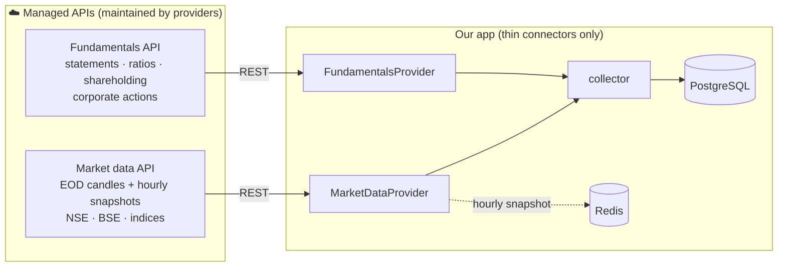

<!-- nav -->[← Previous](03-long-term-analyzer.md) · [🏠 Index](README.md) · [Next →](05-models-and-evaluation.md)

# 04 – Data Sources

**Purpose:** where every value comes from. 🇮🇳 NSE first, BSE optional.

## ✅ Decision: direct connect only, nothing self-maintained
All data comes **directly from managed, official APIs**. No scrapers, no bhavcopy file parsing,
no XBRL parsers, no unofficial libraries. If a provider changes something, the provider maintains it, not us.

| ❌ Not used (maintenance burden) | ✅ Used instead |
|---|---|
| Scraping NSE / Screener / Moneycontrol | Market data API + fundamentals API |
| Bhavcopy download & parsing | Market data API end-of-day candles |
| XBRL filing parsers | Fundamentals API (ready-made statements & ratios) |
| `yfinance`, `jugaad-data`, `nsepy` (unofficial, break often) | Official, documented, versioned APIs |

## ✅ Decision: no broker account
- **No broker account** is connected and **no orders are ever placed** (order placement is a possible future feature)
- **Trade journal values are entered manually** by you ([15](15-trade-journal.md))
- **Prices and financials come from data-only APIs** (no broker login, no daily tokens)
- A broker can still be added later as an optional provider in the admin UI ([22](22-provider-configuration-ui.md))

## Direct-connect sources
| Need | Connect to | What it provides | Exchange |
|---|---|---|---|
| **Historical & EOD prices** | **Market data API**: EODHD, FMP, or an authorized NSE data vendor (TrueData, Global Datafeeds) | Daily OHLCV for backfill and the daily close | NSE (+ BSE) |
| **Hourly snapshots** | Same market data API (delayed / intraday quotes) | Hourly prices during market hours; a ~15-min delay is fine for 50-day+ holds | NSE |
| **Indices & volatility** | Same market data API | NIFTY 50, sector indices, India VIX | NSE |
| **Fundamentals (Screener-like)** | **Fundamentals API**: EODHD, FMP, Trendlyne / Tijori | P&L, balance sheet, cash flow, ratios, shareholding, quarterly results | NSE + BSE |
| **Corporate actions & results dates** | Fundamentals / market data API | Splits, bonuses, dividends, earnings calendar | NSE + BSE |
| **Holidays** | Market data API calendar (or the NSE holiday list entered once a year in the admin UI) | Trading holidays | NSE |
| **Trade plans** | **You (manual entry)** | Stock, start date, entry price, holding category, exit | — |

One provider (e.g., EODHD) can supply **both prices and fundamentals**, so a single subscription may be enough. Check its NSE coverage first (Q40, Q49).

## How it connects

Our code only contains **thin connectors** (`MarketDataProvider`, `FundamentalsProvider`) that call the APIs and save the results.
Switching provider = change it in the **admin UI**, no code change or restart. See [22 – Data Provider Configuration (In-App UI) ⚙️](22-provider-configuration-ui.md).

## What we still compute ourselves
Only the maths, not data collection:
- Technical indicators (RSI, MACD, …) from the candles
- Custom scores and fair value from the fundamentals API values
- Split/bonus adjustment only if the provider doesn't already supply adjusted prices

## Data handling concerns
- Prefer providers that return **adjusted prices** (splits, bonuses, dividends)
- NSE holidays and trading hours (09:15–15:30 IST)
- Respect API rate limits; cache responses
- No broker login or daily token refresh is needed (data-only APIs use a static API key)
- Store raw API responses and processed data separately
- Data is licensed for personal use; don't redistribute it

## EODHD: India coverage, plans and API usage (checked 2026-11-02)
The EODHD plugin is built (Phase 3b, [deliverable](deliverables/phase-03b-real-data.md)); it needs a paid API key.

### India coverage
- **NSE** tickers use the `.NSE` suffix (e.g. `RELIANCE.NSE`, used by the plugin); **BSE** uses `.BSE`.
- EODHD's company pages for Indian stocks show daily prices and fundamentals (income statement, balance sheet,
  cash flow), e.g. [COALINDIA.NSE](https://eodhd.com/financial-summary/COALINDIA.NSE),
  [BANKINDIA.NSE](https://eodhd.com/financial-summary/BANKINDIA.NSE),
  [ABBOTINDIA.NSE](https://eodhd.com/financial-summary/ABBOTINDIA.NSE).
- Fundamentals have gaps for some smaller companies (e.g. [SHANTI.NSE](https://eodhd.com/financial-summary/SHANTI.NSE)
  shows no EPS). The plugin's field mapping is checked against a live response once a key is added (D3b.2 #5).

### Plans ([eodhd.com/pricing](https://eodhd.com/pricing))
| Plan | Price (monthly) | Includes | Fit for this app |
|---|---|---|---|
| Free (Sandbox) | $0 | 1 year of EOD prices, 20 API calls / day | ❌ too few calls: one NIFTY 50 load needs ~550 |
| Historian (EOD) | $19.99 | 30+ years of EOD prices, dividends, splits | 🟡 prices only (no fundamentals) |
| Equity analyst (Fundamentals) | $59.99 | Fundamentals, **no EOD prices** | ❌ the app needs prices |
| All-in-one | $99.99 | EOD + intraday + live + fundamentals | ✅ everything the app uses |

Paid plans: **100,000 API calls / day**, 1,000 requests / minute. Cost per request: EOD 1 call, intraday and
news 5, fundamentals 10. Personal and commercial (B2B) plans are sold separately: check the licence before
others use the app (Q74, owner's legal check).

> With a prices-only plan (Historian) `make real-data` currently stops when the fundamentals request is
> refused; making fundamentals optional (skip with a warning) is a small follow-up.

### API calls the app needs
Prices: 1 call per stock per request; fundamentals: 10 calls per stock.

**NIFTY 50 (current universe)**
| What | When | Calls |
|---|---|---|
| First full load (`make real-data`): 10 years of prices + fundamentals | Once | 50 + 500 = **~550** |
| Daily price update (latest day, 50 stocks) | Every trading day | **~50** |
| Fundamentals refresh (results change quarterly) | Weekly | 500 / week ≈ **70 / day** |
| Connection test (Admin › Providers) | Per click | 1 |
| **Normal day** | | **~50–120** (≈ 550 even with daily fundamentals) |

**All NSE (~2,000 stocks, if the universe grows)**
| What | Calls |
|---|---|
| First full load | ~22,000 (once; fits in one day) |
| Daily prices | ~2,000 / day |
| Weekly fundamentals | ~20,000 / week (≈ 3,000 / day) |
| **Normal day** | **~2,000–5,000** |

Both are far below the 100,000 / day limit, so any paid plan is enough. Today nothing calls EODHD
automatically: calls happen only on `make real-data` and "Test connection"; the daily update becomes
automatic with Phase 6 (scheduler).

## Related
- [11 – Live Cloud Data (Actual Values)](11-live-cloud-data.md)
- [02 – Short-Term Analyzer 🟢](02-short-term-analyzer.md)
- [03 – Long-Term Analyzer 🔵](03-long-term-analyzer.md)
- [22 – Provider Configuration UI](22-provider-configuration-ui.md)
- [Phase 3b – Real Market Data](deliverables/phase-03b-real-data.md)
- [🏠 Index](README.md)

---
<!-- nav -->[← Previous](03-long-term-analyzer.md) · [🏠 Index](README.md) · [Next →](05-models-and-evaluation.md)
