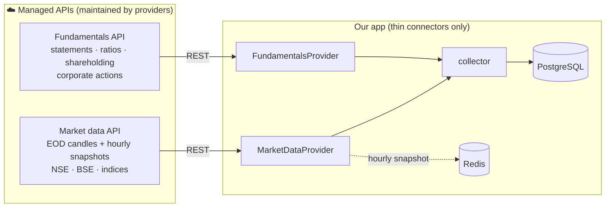

<!-- nav -->[← Previous](03-long-term-analyzer.md) · [🏠 Index](README.md) · [Next →](05-models-and-evaluation.md)

# 04 – Data Sources

**Purpose:** where every value comes from. 🇮🇳 NSE first, BSE optional.

## ✅ Decision: direct connect only, nothing self-maintained
All data comes **directly from managed, official APIs**. No scrapers, no bhavcopy file parsing,
no XBRL parsers, no unofficial libraries. If a provider changes something, the provider maintains it, not us.

| ❌ Not used (maintenance burden) | ✅ Used instead |
|---|---|
| Scraping NSE / Screener / Moneycontrol | Market data API + fundamentals API |
| Bhavcopy download & parsing | Market data API end-of-day candles |
| XBRL filing parsers | Fundamentals API (ready-made statements & ratios) |
| `yfinance`, `jugaad-data`, `nsepy` (unofficial, break often) | Official, documented, versioned APIs |

## ✅ Decision: no broker account
- **No broker account** is connected and **no orders are ever placed** (order placement is a possible future feature)
- **Trade journal values are entered manually** by you ([15](15-trade-journal.md))
- **Prices and financials come from data-only APIs** (no broker login, no daily tokens)
- A broker can still be added later as an optional provider in the admin UI ([22](22-provider-configuration-ui.md))

## Direct-connect sources
| Need | Connect to | What it provides | Exchange |
|---|---|---|---|
| **Historical & EOD prices** | **Market data API**: EODHD, FMP, or an authorized NSE data vendor (TrueData, Global Datafeeds) | Daily OHLCV for backfill and the daily close | NSE (+ BSE) |
| **Hourly snapshots** | Same market data API (delayed / intraday quotes) | Hourly prices during market hours; a ~15-min delay is fine for 50-day+ holds | NSE |
| **Indices & volatility** | Same market data API | NIFTY 50, sector indices, India VIX | NSE |
| **Fundamentals (Screener-like)** | **Fundamentals API**: EODHD, FMP, Trendlyne / Tijori | P&L, balance sheet, cash flow, ratios, shareholding, quarterly results | NSE + BSE |
| **Corporate actions & results dates** | Fundamentals / market data API | Splits, bonuses, dividends, earnings calendar | NSE + BSE |
| **Holidays** | Market data API calendar (or the NSE holiday list entered once a year in the admin UI) | Trading holidays | NSE |
| **Trade plans** | **You (manual entry)** | Stock, start date, entry price, holding category, exit | — |

One provider (e.g., EODHD) can supply **both prices and fundamentals**, so a single subscription may be enough. Check its NSE coverage first (Q40, Q49).

## How it connects

Our code only contains **thin connectors** (`MarketDataProvider`, `FundamentalsProvider`) that call the APIs and save the results.
Switching provider = change it in the **admin UI**, no code change or restart. See [22 – Data Provider Configuration (In-App UI) ⚙️](22-provider-configuration-ui.md).

## What we still compute ourselves
Only the maths, not data collection:
- Technical indicators (RSI, MACD, …) from the candles
- Custom scores and fair value from the fundamentals API values
- Split/bonus adjustment only if the provider doesn't already supply adjusted prices

## Data handling concerns
- Prefer providers that return **adjusted prices** (splits, bonuses, dividends)
- NSE holidays and trading hours (09:15–15:30 IST)
- Respect API rate limits; cache responses
- No broker login or daily token refresh is needed (data-only APIs use a static API key)
- Store raw API responses and processed data separately
- Data is licensed for personal use; don't redistribute it

## Related
- [11 – Live Cloud Data (Actual Values)](11-live-cloud-data.md)
- [02 – Short-Term Analyzer 🟢](02-short-term-analyzer.md)
- [03 – Long-Term Analyzer 🔵](03-long-term-analyzer.md)
- [🏠 Index](README.md)

---
<!-- nav -->[← Previous](03-long-term-analyzer.md) · [🏠 Index](README.md) · [Next →](05-models-and-evaluation.md)
