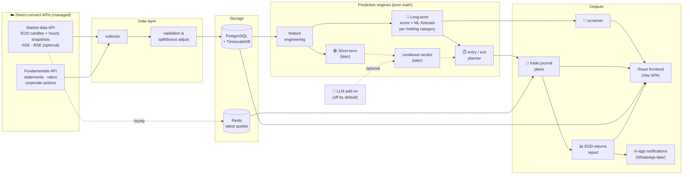

<!-- nav -->[← Previous](06-app-features.md) · [🏠 Index](README.md) · [Next →](08-non-functional.md)

# 07 – Architecture & Tech Stack

**Purpose:** the big picture: components, daily data flow and the tech stack. Code layers and folders are in [24 – Coding Standards & Clean Architecture 📏](24-coding-standards.md).

## System architecture


## Daily data flow
```mermaid
sequenceDiagram
    autonumber
    participant S as scheduler
    participant C as collector
    participant DB as PostgreSQL
    participant W as worker
    participant M as monitor
    participant N as notifier

    S->>C: 08:30 refresh corporate actions & holidays
    loop every hour 10:15 – 15:15
        C->>M: hourly quote snapshot (market data API)
        M->>DB: update active journal plans; check target / stop-loss
        M-->>N: alert on trigger
    end
    S->>C: 15:45 fetch closing prices
    C->>DB: save EOD prices
    S->>W: 16:00 compute returns & accuracy
    W->>N: 16:15 send daily returns report
    S->>C: 18:00 re-fetch final EOD candles (market data API)
    S->>W: 20:00 features + nightly predictions (all stocks × categories)
    S->>W: weekend: retrain models, backtests, fundamentals refresh
```

## Repository layout
`backend/` (FastAPI, Clean Architecture) and `frontend/` (React, feature-based). Layers, trees and naming rules: [24 – Coding Standards & Clean Architecture 📏](24-coding-standards.md). Overview in [23 – Frontend (React) & Backend Split 🖥️](23-frontend-react.md#repository-layout).

## Tech stack
| Layer | Choice |
|---|---|
| Frontend | **React + TypeScript (Vite)**, shadcn/ui + Tailwind, TanStack Query/Table, TradingView Lightweight Charts, Recharts ([23](23-frontend-react.md)) |
| Backend API | **FastAPI** + Pydantic v2 (the React app calls it via `/api`) |
| Architecture | Clean Architecture: domain · application · infrastructure · presentation ([24](24-coding-standards.md)) |
| Database | **PostgreSQL 16 + TimescaleDB + pgvector**, SQLAlchemy 2 (async) + asyncpg + Alembic ([17](17-database-backend.md)) |
| Observability | **OpenTelemetry** (traces, metrics, logs) → Grafana `otel-lgtm` (Loki, Tempo, Prometheus), or JSON Lines files |
| Cache / queue | Redis (latest snapshots, job queue) |
| Data & maths | pandas, numpy, `Decimal` for money |
| Indicators | `pandas-ta` (or our own calculators in the domain layer) |
| ML / stats | scikit-learn, LightGBM / XGBoost (quantile), statsmodels, MAPIE (conformal), lifelines (survival) |
| Optional ML | FinBERT (sentiment, short-term), PyTorch (only if deep models prove useful) |
| Scheduling | APScheduler, timezone-aware per market |
| Auth | OAuth 2.0 / OIDC (Google, Microsoft) via Authlib ([19](19-auth-multi-user.md)) |
| Secrets | Provider credentials **encrypted in the database** (Fernet), entered in the admin UI ([22](22-provider-configuration-ui.md)); `.env` holds only bootstrap values (database URL, master key) |
| ML pipeline | Feature store, triple-barrier labels, LightGBM per category, conformal ranges, MLflow registry ([26](26-ml-pipeline.md)) |
| Quality | pytest, mypy, ruff, import-linter, Vitest, Playwright, ESLint, Prettier, pre-commit |

## Deployment
Runs as a Docker Compose stack: `db`, `redis`, `api`, `web`, `collector`, `scheduler`, `worker`, `monitor`, `notifier`, `otel-lgtm` (+ optional `mlflow`, `ollama`). See [14 – Docker Deployment & 24/7 Operation 🐳](14-docker-deployment.md) and [20 – Environments: Dev, Test & Prod 🧪](20-environments-dev-test-prod.md). Full inventory: [25 – Infrastructure, Services & Requirements Inventory 🧰](25-infrastructure-services-inventory.md).

## Additions: LLM & live data
- `infrastructure/providers/llm/`: provider-agnostic LLM layer (OpenAI or local). See [10](10-ai-llm-integration.md).
- `infrastructure/providers/` (adapters + failover registry) and `application/use_cases/data/` (hourly snapshot, EOD): hourly + end-of-day data with a fallback provider. See [11](11-live-cloud-data.md).
- Extra libraries: `openai`, `ollama` (optional), `httpx`, `tenacity` (retries)

## Related
- [08 – Non-Functional Requirements](08-non-functional.md)
- [10 – AI / LLM Integration (OpenAI or Local Models)](10-ai-llm-integration.md)
- [11 – Live Cloud Data (Actual Values)](11-live-cloud-data.md)
- [🏠 Index](README.md)

---
<!-- nav -->[← Previous](06-app-features.md) · [🏠 Index](README.md) · [Next →](08-non-functional.md)
