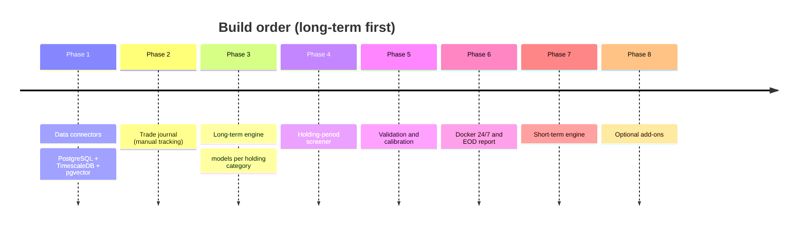

<!-- nav -->[← Previous](08-non-functional.md) · [🏠 Index](README.md) · [Next →](10-ai-llm-integration.md)

# 09 – Roadmap

**Focus: long-term first** (50 days – multi-year). Short-term comes later.

**Phase 1 starts as a POC on synthetic data** (mock provider, baseline predictions, thin journal and UI); real APIs follow. Plan: [27](27-phase1-poc-plan.md). Outcomes and acceptance criteria per phase: [deliverables/](deliverables/README.md).

| Phase | Scope | Outcome |
|---|---|---|
| 1 – Foundation | Clean Architecture skeleton + lint/type/test tooling ([24](24-coding-standards.md)), Provider plugin registry + admin provider settings screen ([22](22-provider-configuration-ui.md)), Local Docker dev/test setup ([20](20-environments-dev-test-prod.md)), PostgreSQL (TimescaleDB, pgvector), FastAPI skeleton, React (Vite) frontend skeleton ([23](23-frontend-react.md)), mock provider + first market data API connector, **NIFTY 50** history backfill (all NSE stocks later). Setup checklist: [25](25-infrastructure-services-inventory.md#11-setup-checklist-before-phase-1) | Clean data in the database |
| 2 – Trade Journal | Select stock, start date, holding category, locked prediction, daily tracking, mark outcome and exit ([15](15-trade-journal.md)) | **You can track plans manually** |
| 3 – Long-Term Engine | ML pipeline ([26](26-ml-pipeline.md)), data points ([21](21-stock-analysis-datapoints.md)), quality score, fair value, quantile models per category (50D … 3Y), triple-barrier labels, probability of hitting targets ([03](03-long-term-analyzer.md), [18](18-methods-accuracy-references.md)) | Predictions with ranges for every stock |
| 4 – Screener | Filter by holding category + target % + probability ([16](16-holding-period-screener.md)); historical analogs via pgvector | "50 days, 20% → which stocks?" |
| 5 – Validation | Purged walk-forward backtests, calibration checks, journal track record | Proven (or disproven) usefulness |
| 5b – Users | OAuth sign-in (Google, Microsoft), roles, per-user journals ([19](19-auth-multi-user.md)) | Other users can sign in |
| 5c – WhatsApp | WhatsApp Business Cloud API notifier: daily report + alerts, approved templates, user opt-in ([13](13-daily-returns-report.md#notification-channels-later)) | Reports on WhatsApp |
| 6 – Daily Ops | Docker Compose, 24/7 scheduler, EOD report, alerts ([13](13-daily-returns-report.md), [14](14-docker-deployment.md)) | Runs unattended |
| 7 – Short-Term | 1 day – 2 weeks engine ([02](02-short-term-analyzer.md)) | Later |
| 8 – Optional | LLM add-on ([10](10-ai-llm-integration.md)), auto paper trading | Later |

## Related
- [01 – Overview & Goals](01-overview.md)
- [28 – Open Questions](28-open-questions.md)
- [🏠 Index](README.md)

---
<!-- nav -->[← Previous](08-non-functional.md) · [🏠 Index](README.md) · [Next →](10-ai-llm-integration.md)
