<!-- nav -->[← Previous](10-ai-llm-integration.md) · [🏠 Index](README.md) · [Next →](12-entry-exit-strategy.md)

# 11 – Live Cloud Data (Actual Values)

**Requirement:** every price and financial value shown must be the latest real value from a cloud data provider.

## ✅ Decision: hourly snapshots + end-of-day (no intraday trading)
We don't trade intraday, so real-time streaming isn't needed.
**During market hours, take an hourly price snapshot. After the close, store the official end-of-day candle.**

## Freshness options analysed
| Option | Latency | Needed for us? | Why |
|---|---|---|---|
| Real-time streaming (WebSocket) | < 1 sec | ❌ No | Only useful for intraday trading; adds complexity (connections, reconnects, tick storage) |
| 15-min delayed | ~15 min | ✅ Acceptable | Data-only APIs often deliver delayed intraday quotes; for 50-day+ holds a 15-minute delay doesn't matter |
| **Hourly snapshot (REST quote)** | ≤ 1 hour | ✅ **Yes** | Enough to update plan progress and warn when a target or stop-loss is near or crossed |
| **End-of-day candle** | Daily | ✅ **Yes (primary)** | Official close for models, predictions, the screener, the journal and the daily report |

## Schedule (IST, trading days only)
| Time | Job | API call |
|---|---|---|
| 10:15, 11:15, 12:15, 13:15, 14:15, 15:15 | Hourly snapshot for active plans + watchlist | Market data API quote (may be ~15 min delayed), batched |
| 15:45 – 17:00 | End-of-day candles for the whole universe | Market data API EOD candles (timing depends on when the provider publishes) |
| 18:00 | Re-fetch final EOD candles; correct differences | Same |
| Weekly / after results | Fundamentals refresh | Fundamentals API |

```mermaid
gantt
    title Trading day data jobs (IST)
    dateFormat HH:mm
    axisFormat %H:%M
    section Market
    Market open            :active, m, 09:15, 15:30
    section Hourly snapshots
    10:15 :milestone, 10:15, 0m
    11:15 :milestone, 11:15, 0m
    12:15 :milestone, 12:15, 0m
    13:15 :milestone, 13:15, 0m
    14:15 :milestone, 14:15, 0m
    15:15 :milestone, 15:15, 0m
    section End of day
    EOD candles + report   :e, 15:45, 30m
    Final reconciliation   :r, 18:00, 15m
```

**Note:** with hourly checks, the price can cross a stop-loss or target between snapshots. Alerts say *"crossed since the last check"*,
and the plan uses the **end-of-day close** as the official value. That's acceptable for 50-day to multi-year holds.

## Broker API comparison (optional, for later; from public sources, October 2026)
> ⏭️ **Not used now.** No broker account is connected ([04](04-data-sources.md#-decision-no-broker-account)). Kept for reference if a broker is added later.

| Broker API | Cost | Historical candles | Login for 24/7 use | Notes |
|---|---|---|---|---|
| **Zerodha Kite Connect** | ₹500/month per API key (Connect plan, includes historical data); the free Personal plan has **no market data** | ✅ | Daily login token | Most mature and best documented |
| **Upstox API** | Reported free | ✅ Days/weeks/months since 2000, minutes/hours since 2022 (V3) | Daily token | Free core data; expired contracts need Upstox Plus |
| **Angel One SmartAPI** | Reported free (no monthly charge) | ✅ (`getCandleData`) | TOTP login, can run unattended | Popular for unattended data pipelines |
| **Dhan** | Trading API free; Data API ₹499 + taxes/month | ✅ Included in the Data API | Long-lived token (no daily login) | Simplest for 24/7 |
| **Fyers** | Not checked | ✅ | Daily token | Check current terms |

**If a broker is added later:** for hourly + EOD data, a **free** broker API covers everything.
- Start with **Upstox** or **Angel One** (free). Angel One's TOTP login suits the unattended 24/7 Docker setup.
- **Dhan** (₹499/month) is the simplest if you want to avoid daily logins.
- **Kite Connect** (₹500/month) if you already use Zerodha.
- Keep a second free broker as the fallback.

Sources: [Zerodha Kite Connect](https://zerodha.com/products/api/) · [Zerodha free personal APIs](https://zerodha.com/z-connect/updates/free-personal-apis-from-kite-connect) · [Upstox historical candle API](https://upstox.com/developer/api-documentation/get-historical-candle-data/) · [Upstox announcements](https://upstox.com/developer/api-documentation/announcements/) · [Broker API charges comparison 2026](https://cernoquant.com/blog/broker-api-charges-comparison) · [Dhan API charges](https://cernoquant.com/blog/dhan-api-charges) · [Angel One API market data](https://www.oidata.in/blog/angel-one-api-market-data)

## Fetching strategy
- **Hourly:** one batched REST quote call for all active plans and watchlist stocks
- **History:** load once (backfill), then add each day's EOD candle
- **Fundamentals:** refresh weekly and after results dates
- **Scheduler:** APScheduler, IST timezone, skips NSE holidays and weekends

## Reliability
- A **primary market data provider**, with an optional second data provider as a fallback
- Cache the latest values; mark data as **stale** in the UI if an update fails
- Show the "last updated" timestamp and the source next to every value
- Respect rate limits (queue + backoff)
- Validate: no negative prices, no sudden 90% jumps without a split event

## Data layer design
Following the Clean Architecture layers in [24 – Coding Standards & Clean Architecture 📏](24-coding-standards.md):
| Piece | Location |
|---|---|
| Ports (interfaces) | `application/ports/providers.py`: `MarketDataProvider`, `FundamentalsProvider` |
| Use cases | `application/use_cases/data/`: `BackfillPrices`, `TakeHourlySnapshot`, `FetchEndOfDayCandles` |
| Adapters (plugins) | `infrastructure/providers/<vendor>/`: `client.py`, `mapper.py`, `provider.py` |
| Registry + failover router | `infrastructure/providers/registry.py` |
| Job entry points | `presentation/jobs/` |

Providers are chosen in the admin UI ([22](22-provider-configuration-ui.md)).

## How it connects to predictions
1. Fetch the latest actual values from the cloud
2. Compute features (technical indicators / fundamentals)
3. Models predict the % values
4. Optional: the LLM explains the result using those same fetched values
5. The UI shows actual value + prediction + timestamp + source

## Related
- [04 – Data Sources](04-data-sources.md)
- [07 – Architecture & Tech Stack](07-architecture.md)
- [08 – Non-Functional Requirements](08-non-functional.md)
- [🏠 Index](README.md)

---
<!-- nav -->[← Previous](10-ai-llm-integration.md) · [🏠 Index](README.md) · [Next →](12-entry-exit-strategy.md)
