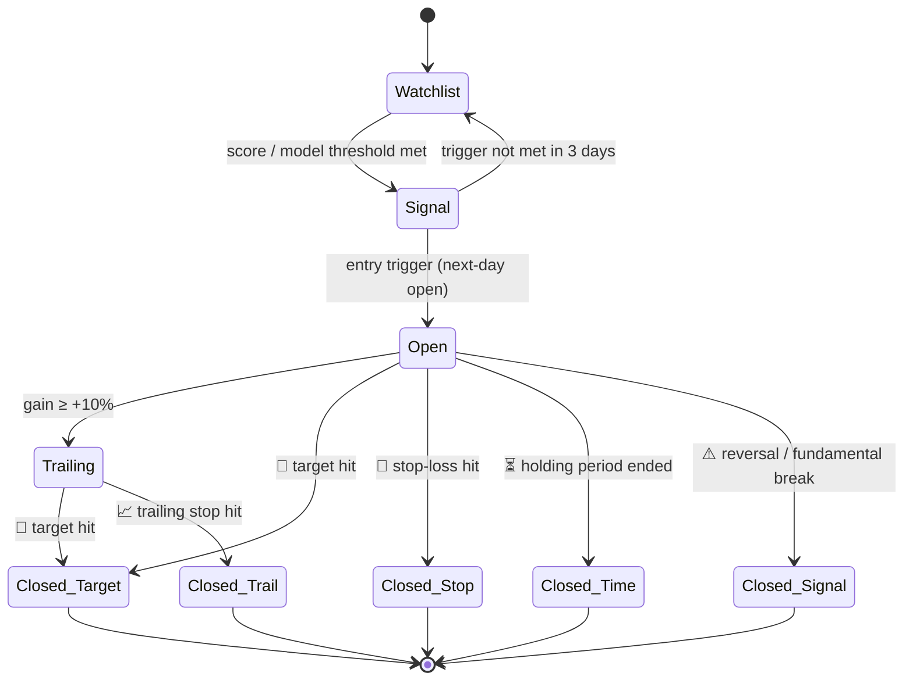
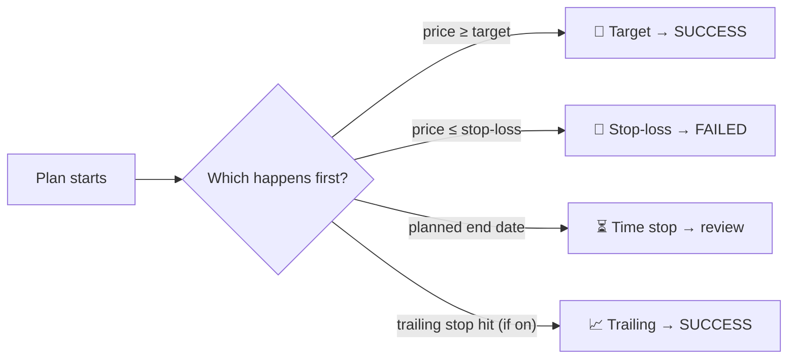

<!-- nav -->[← Previous](11-live-cloud-data.md) · [🏠 Index](README.md) · [Next →](13-daily-returns-report.md)

# 12 – Entry & Exit Strategy ⏱️

**Purpose:** turn predictions into actionable trade plans: **when to enter, how long to hold, when to exit**,
with an expected % return. Example: *"Enter at ₹1,640 → hold ~50 days → target +20% (₹1,968), stop-loss −7%."*

## Trade plan output (both engines)
```
RELIANCE – 🔵 Positional plan
Entry zone:        ₹2,880 – ₹2,920   (trigger: close above 50-DMA with volume)
Holding period:    ~50 trading days (range 35–65)
Target:            +20%  → ₹3,480        Probability of hitting target: 41%
Stop-loss:         −7%   → ₹2,700
Trailing stop:     activates after +10%, trails at 8% below the high
Risk : Reward:     1 : 2.9
Expected return:   +8.6% (probability-weighted)
Exit by:           2026-12-31 (time stop) if target/stop not hit
```

## Trade lifecycle
The first implementation is the **manual trade journal** ([15](15-trade-journal.md)): you start and close plans yourself, and the system tracks them.
The automated lifecycle below (signals opening virtual positions) comes later.



## 1. Entry signals (when to start)
### 🟢 Short-term (1 day – 2 weeks) · ⏭️ later
- Breakout above resistance / previous high with volume above the 20-day average
- RSI recovering from oversold (< 30 → above 35), MACD bullish crossover
- Pullback to the 20-EMA in an uptrend
- Model probability of going up ≥ threshold (e.g., 60%)
- Filters: NIFTY trend positive, no results announcement within the holding window

### 🔵 Long-term / positional (e.g., 50 days and longer)
- Quality score ≥ 7/10 **and** price below fair value (rule-based)
- ML forecast: expected return over N days ≥ target (e.g., +15% in 50 days) with probability ≥ threshold
- Technical confirmation: price above the 200-DMA, or a golden cross (50-DMA crosses above 200-DMA)
- Staggered entry option: buy in 2–3 tranches

## ✅ Decision: exit style = combination
Every plan has **three exits; whichever happens first ends the plan**:
| Exit | Default | Outcome |
|---|---|---|
| 🎯 Fixed target | The predicted % for the holding category (e.g., +20%) | SUCCESS |
| 🛑 Fixed stop-loss | A set % below entry (e.g., −7%) or ATR-based | FAILED |
| ⏳ Time stop | The planned end date of the holding category (50D, 100D …) | Review: SUCCESS / PARTIAL / FAILED |
| 📈 Trailing stop | **Optional per plan, off by default**; activates after a gain (e.g., +10%) | SUCCESS (profit locked) |


This matches the journal's "one start, one end, one exit" rule ([15](15-trade-journal.md)) and the **triple-barrier** labels the models are trained on ([18](18-methods-accuracy-references.md)).

## 2. Exit signals (when to stop)
| Exit type | Rule | Applies to |
|---|---|---|
| 🎯 Target | Price reaches the target % | Both |
| 🛑 Stop-loss | Fixed % or ATR-based (e.g., 2 × ATR below entry) | Both |
| 📈 Trailing stop | Follows the price up after a gain threshold | Both |
| ⏳ Time stop | Exit after the planned holding period if neither the target nor the stop is hit | Both |
| ⚠️ Signal reversal | Model probability falls below 45%, or a bearish MACD crossover | Short-term |
| 📉 Fundamental break | Quality score drops, or results miss badly | Long-term |
| 🗓️ Event risk | Exit or reduce before results if the risk is too high | Both |

## 3. Holding-period prediction
How the "hold ~50 days → ~20%" number is produced:
1. **Multi-horizon models:** one model per holding category: **50D, 100D, 200D, 300D, 1Y, 2Y, 3Y** ([16](16-holding-period-screener.md)) (short-term 1–10 days later).
   Each predicts the expected return and the probability of hitting +X%.
2. **Target-hit model:** for each target % (10/15/20%), predict the probability of reaching it before the stop-loss,
   and the expected number of days to get there (survival analysis / quantile regression).
3. **Best plan selection:** choose the horizon/target combination with the best risk-adjusted expected value.
4. **Historical analogs:** "In similar past setups, the median was +18% over 47 days (62 cases)."

## 4. Position sizing & risk
- ✅ **Risk per trade: custom per user, default 1%** of capital (Settings › Risk)
- **Suggested amount** = (capital × risk %) ÷ stop-loss %. Example: ₹1,00,000 × 1% ÷ 7% ≈ **₹14,300**
- The suggestion is shown when you start a plan; you can enter your own amount
- Maximum allocation per stock and per sector
- Risk : reward of at least 1 : 2 before a signal is shown as "Buy"

## 5. India cost & tax impact (applied to net returns)
| Item | Notes |
|---|---|
| Brokerage | Varies by broker (₹0 delivery at many discount brokers; intraday is charged) |
| STT, exchange charges, stamp duty, GST, SEBI fee | Applied on each buy/sell |
| STCG (held < 12 months) | Taxed at 20% (per Budget 2024; verify the current rate) |
| LTCG (held ≥ 12 months) | 12.5% above ₹1.25 lakh per year (verify the current rate) |

Show **gross and net % return**. A 50-day hold falls under STCG, which matters when comparing plans.

## 6. Evaluation
- Backtest full trade plans (entry + exit rules), not just the predictions
- Metrics: win rate, average gain vs average loss, expectancy, average holding days, max drawdown, CAGR vs NIFTY 50
- Calibration: when the app says "41% chance of hitting the target", it should happen about 41% of the time

## 7. Alerts
- Entry triggered, target hit, stop-loss hit, trailing stop moved, time stop reached

## Related
- [02 – Short-Term Analyzer 🟢](02-short-term-analyzer.md)
- [03 – Long-Term Analyzer 🔵](03-long-term-analyzer.md)
- [05 – Models & Evaluation](05-models-and-evaluation.md)
- [🏠 Index](README.md)

---
<!-- nav -->[← Previous](11-live-cloud-data.md) · [🏠 Index](README.md) · [Next →](13-daily-returns-report.md)
