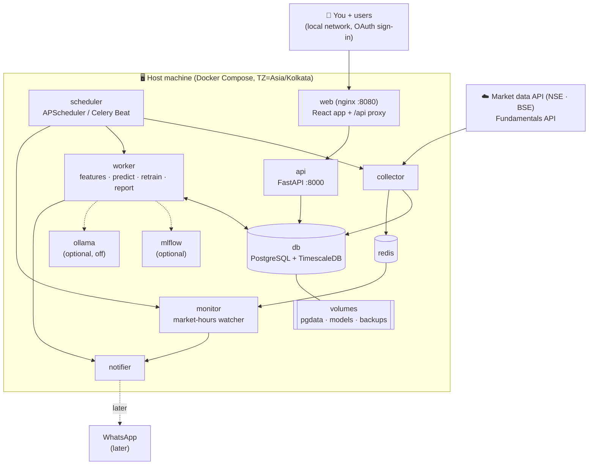

<!-- nav -->[← Previous](13-daily-returns-report.md) · [🏠 Index](README.md) · [Next →](15-trade-journal.md)

# 14 – Docker Deployment & 24/7 Operation 🐳

**Purpose:** run the whole system **24/7 on your own machine** as a Docker Compose stack that restarts itself,
schedules all jobs, and keeps its data safe.

## What runs when (24/7 schedule, IST)
| Time | Activity |
|---|---|
| 08:30 | Pre-market: corporate actions, results calendar, holidays from the APIs |
| 09:00 | Load the latest nightly predictions; prepare plan tracking for the day |
| 10:15 – 15:15 (hourly) | **Market hours:** hourly quote snapshot; update active journal plans; check stop-loss/target; alerts |
| 15:45 – 16:15 | **End-of-day:** close prices, returns, [daily report](13-daily-returns-report.md) |
| 18:00 | Re-fetch final EOD candles (market data API) |
| 20:00 – 02:00 | Feature calculation, **nightly predictions** (all stocks × holding categories) |
| 03:00 | Database backup |
| Weekends | Full retrain, fundamentals refresh, long backtests |

## Containers (docker-compose services)
The complete list of services, ports, volumes, accounts and configuration is in [25 – Infrastructure, Services & Requirements Inventory 🧰](25-infrastructure-services-inventory.md).

| Service | Role |
|---|---|
| `db` | PostgreSQL (+ TimescaleDB for time series) |
| `redis` | Cache for latest quotes, job queue |
| `collector` | Fetches EOD candles, hourly quotes, fundamentals, corporate actions |
| `scheduler` | APScheduler / Celery Beat: triggers every job on the IST schedule |
| `worker` | Runs features, predictions, retraining, backtests, reports |
| `monitor` | Live position watcher during market hours (targets, stops) |
| `notifier` | In-app notifications and the daily report for now; WhatsApp later ([13](13-daily-returns-report.md#notification-channels-later)) |
| `api` | FastAPI backend (port 8000, internal) |
| `web` | nginx: serves the React build and proxies `/api` (port 8080) |
| `otel-lgtm` | OpenTelemetry + Grafana (logs, traces, metrics) at `:3000` (profile `telemetry`) |
| `mlflow` (recommended) | Experiment tracking + model registry ([26](26-ml-pipeline.md)) |
| `llm` (optional, off) | Ollama, only if the LLM add-on is enabled. Prod: container on the NVIDIA GPU. Dev on a Mac: runs natively, outside Docker |

## Container diagram


## Sketch of docker-compose.yml
```yaml
services:
  db:
    image: timescale/timescaledb-ha:pg16.15-ts2.31.0   # full build (not -oss), includes pgvector
    volumes: [pgdata:/var/lib/postgresql/data]
    restart: unless-stopped
    healthcheck: { test: ["CMD", "pg_isready"], interval: 30s }
  redis:
    image: redis:7.4.12-alpine3.21
    restart: unless-stopped
  scheduler:
    build: .
    command: python -m stock_analyzer.scheduler
    env_file: .env
    environment: { TZ: Asia/Kolkata }
    depends_on: [db, redis]
    restart: unless-stopped
  worker:
    build: .
    command: python -m stock_analyzer.worker
    env_file: .env
    environment: { TZ: Asia/Kolkata }
    volumes: [models:/app/models]
    restart: unless-stopped
  api:
    build: ./backend
    command: uvicorn app.main:app --host 0.0.0.0 --port 8000
    env_file: .env
    depends_on: [db]
    restart: unless-stopped
  web:
    build: ./frontend          # node build stage → nginx serving dist/
    ports: ["8080:80"]
    depends_on: [api]
    restart: unless-stopped
volumes: { pgdata: {}, models: {} }
```
(Final versions will be pinned; this is a planning sketch.)

## 24/7 reliability
- `restart: unless-stopped` plus health checks on every service
- **Idempotent jobs:** re-running a job for the same date never duplicates data
- **Catch-up on restart:** if the machine was off, the scheduler runs the missed jobs (e.g., an EOD report)
- Market-hours aware: no live polling on holidays/weekends
- A heartbeat alert (in-app for now; WhatsApp later) if a job fails or no data has arrived for 10 minutes
- Logs: JSON logs, rotated (e.g., via Docker's log driver limits)

## Host machine requirements
| Item | Minimum | Recommended |
|---|---|---|
| CPU | 4 cores | 8 cores |
| RAM | 8 GB | 16 GB (32 GB if the local LLM is enabled) |
| Disk | 50 GB SSD | 200 GB SSD |
| Network | Stable broadband | Wired + UPS for power cuts |
| OS | Linux, macOS, or Windows + WSL2 with Docker | **Prod: Ubuntu Server 24.04 LTS** with Docker Engine |
| Sleep | Disable sleep / auto-restart after power loss | ✅ |

## Data safety & security
- Docker volumes for the database and models; nightly `pg_dump` backups, with a copy kept off the machine
- Secrets in `.env` (bootstrap values only; provider API keys are encrypted in the database), never committed to git
- **For now:** the dashboard is reachable only from the local machine / network
- **Remote access is not required.** If it is ever needed, deploy the same stack to a hosted server instead of exposing the home machine ([19](19-auth-multi-user.md#exposing-the-app-to-other-users))
- No broker is connected and the app **never places orders**

## Environments
Dev and test run locally; prod runs on a Linux server later. Compose override files, test strategy and promotion are in [20 – Environments: Dev, Test & Prod 🧪](20-environments-dev-test-prod.md).

## Deployment workflow
1. `git clone` → copy `.env.example` to `.env` and fill in the keys
2. `docker compose up -d --build`
3. Run the initial history backfill job (one time)
4. Check the dashboard at `http://<machine-ip>:8080`
5. Updates: `git pull && docker compose up -d --build`

## Related
- [07 – Architecture & Tech Stack](07-architecture.md)
- [08 – Non-Functional Requirements](08-non-functional.md)
- [11 – Live Cloud Data (Actual Values)](11-live-cloud-data.md)
- [13 – End-of-Day Returns Report 📊](13-daily-returns-report.md)
- [🏠 Index](README.md)

---
<!-- nav -->[← Previous](13-daily-returns-report.md) · [🏠 Index](README.md) · [Next →](15-trade-journal.md)
