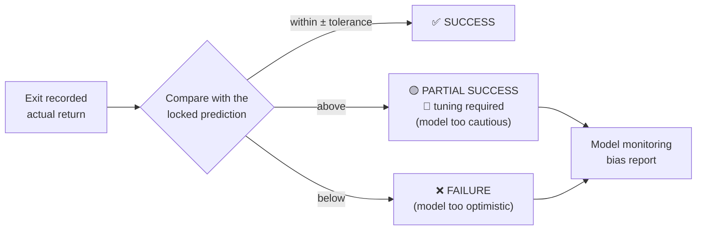
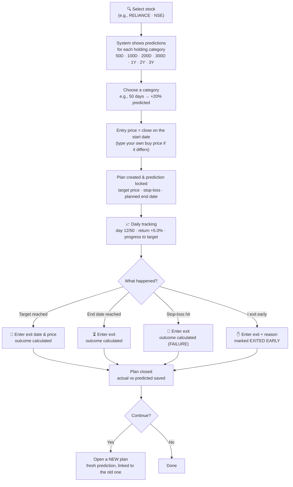
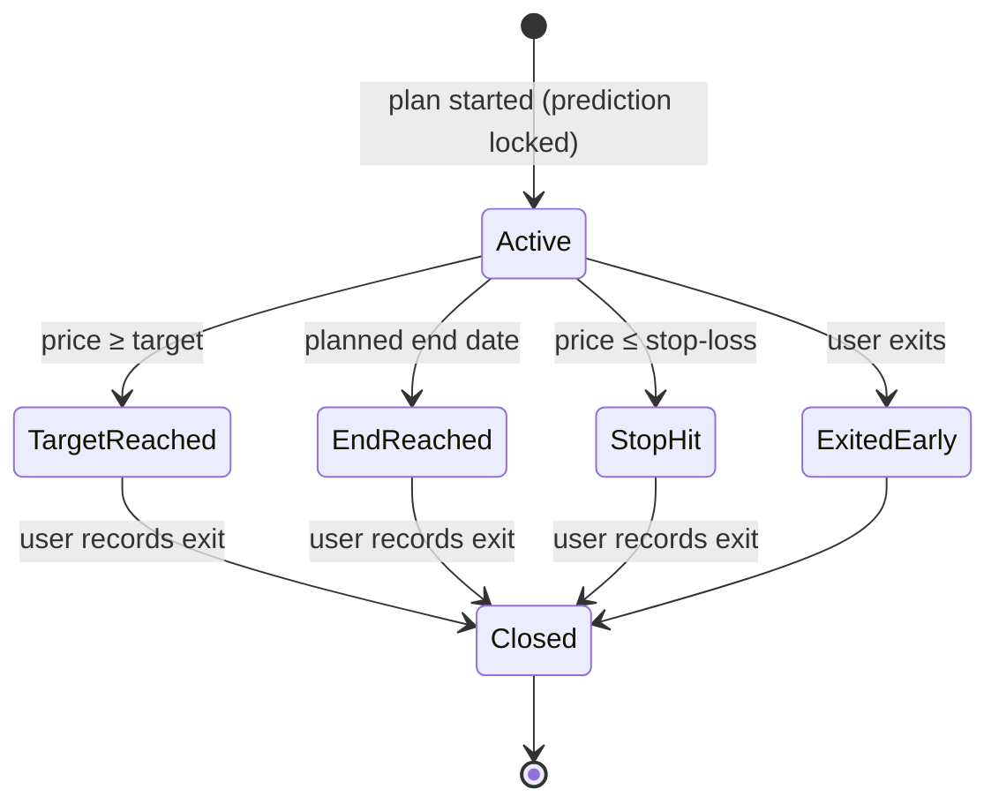

<!-- nav -->[← Previous](14-docker-deployment.md) · [🏠 Index](README.md) · [Next →](16-holding-period-screener.md)

# 15 – Trade Journal (Manual Tracking) 📒

**Purpose:** let you track a holding plan in the app, entering every value **manually** (no broker, no orders): pick a stock, record the start, the planned holding days,
the system's predicted %, then mark the outcome and your exit. This is the **first capability to build** (long-term only).

## Discipline rules (business mindset, not greedy)
1. **One plan = one start, one planned end, one exit.**
2. When you start a plan, the system's prediction is **locked (snapshot)**. It can't be edited later, so the track record stays honest.
3. **No extending a running plan** to chase more %. If you want to continue after the end, **close it and open a new plan**
   with a fresh prediction. The new plan is linked to the old one (`parent_plan_id`).
4. When the target is reached, the app says **"Target reached, exit as planned."**
5. Wrong predictions are recorded as **failures**, never hidden. They are what improves the system.

## ✅ Definition of SUCCESS (prediction accuracy)
The outcome measures **how accurate the system's prediction was**, not only whether money was made.
It compares the **actual return** at exit with the **predicted return** locked when the plan started.

| Actual vs predicted | Outcome | Meaning | Example (predicted +10%) |
|---|---|---|---|
| **Equal** (within the tolerance) | ✅ **SUCCESS** | Prediction was right | Actual +10% |
| **Above** the prediction | 🟡 **PARTIAL SUCCESS** + 🔧 **tuning required** | Made money, but the model **under-predicted**, so it needs tuning | Actual +11% or +15% |
| **Below** the prediction | ❌ **FAILURE** | Prediction failed | Actual +8%, 0% or −5% |

- **Tolerance:** an exact match is rare, so "equal" means **within ± a tolerance**
  - ✅ **Default: ±0.5 percentage points**: predicted +10% → SUCCESS from **+9.5% to +10.5%**; +11% = PARTIAL; +9.4% = FAILURE
  - **Configurable** on the Settings page (one app-wide record until user accounts, Q63); it can also be changed on a plan **before it starts**
  - The tolerance is **saved with each plan** when it starts, so changing the setting later never rewrites past outcomes
- The outcome is **calculated automatically** from the exit price you enter; you can add a note but can't override it (keeps the record honest)
- ✅ **Own target (Q31):** you may set your own target %. It drives the target price and the progress bar, but the outcome is always judged against the **locked prediction** (`predicted_pct`); whether you reached your own target is reported separately (`is_own_target_met`, 'Your targets reached' in the track record)
- ✅ **Holding days (Q28):** categories are **calendar days** (50D = 50 calendar days); an end date on a weekend or holiday moves to the next trading day
- The **net return** (profit/loss) is stored separately, so a plan can be a prediction *FAILURE* and still be profitable (e.g., +8% vs +10% predicted)
- Every **PARTIAL (tuning required)** and **FAILURE** is fed back to the model monitoring ([26](26-ml-pipeline.md#8-monitoring)):
  many PARTIALs mean the model is **too cautious**; many FAILUREs mean it is **too optimistic**



## User flow


## Plan lifecycle


## Fields per plan
| Field | Entered by | Example |
|---|---|---|
| Stock & exchange | You | RELIANCE · NSE |
| Holding category | You (from the system's options) | 50 days |
| Start date | You | 2026-10-27 |
| Entry price | ✅ Q29: the API close on the start date, **editable** to your actual buy price; the close is kept as `reference_close` and the source as CLOSE / MANUAL | ₹2,900 |
| Planned end date | System (NSE trading calendar) | 2027-01-08 |
| Predicted % (median + range) | System, locked | +20% target · median +9% · range −6% to +24% |
| Probability of reaching target | System, locked | 41% |
| Target price / stop-loss | System (editable before start only) | ₹3,480 / ₹2,700 |
| Suggested amount | System (server-side, `POST /api/trade-plans/preview`): (capital × risk %) ÷ \|stop-loss %\|, capped at the capital, whole shares; capital and risk from Settings (default 1%) | 48 sh · ₹1,41,600 |
| Success tolerance | From Settings (default ±0.5 pp), locked at start | ±0.5 pp |
| Trailing stop | Optional, off by default (you switch it on per plan) | Activate at +10%, trail 8% |
| Current price, return, day count | System, from EOD candles (`progress` on every plan; `make track` stores daily snapshots); stops at the planned end date | ₹3,045 · +5.0% · day 12 of 35 (trading days) |
| Flags | System: target reached (day high ≥ target price), stop-loss crossed (day low ≤ stop price), end date reached; **never closes the plan**, you enter the exit | 🎯 Target reached 07 Jan |
| Outcome | **System (calculated)** from actual vs predicted | SUCCESS / PARTIAL SUCCESS (tuning required) / FAILURE / EXITED EARLY |
| Net return | System | Actual profit/loss after costs, stored separately from the outcome |
| Exit date & price | You | 2026-12-30 · ₹3,490 |
| Notes / reason | You | "Target hit, exited as planned" |
| Parent plan | System | link to the previous plan, if this one continues it |

## Screens
```
📒 My Plans                                              [+ New plan]
Stock     Category  Start       Day     Entry   Now     Return  Target  Status
RELIANCE  50D       2026-10-27  12/50   ₹2,900  ₹3,045  +5.0%   +20%    🟡 Active
HDFCBANK  100D      2026-08-01  done    ₹1,610  ₹1,905  +18.3%  +15%    ✅ Success
ITC       50D       2026-07-10  done    ₹470    ₹441    −6.2%   +12%    ❌ Failed (stop)

Track record:  plans 14 · success 8 (57%) · avg actual +6.1% vs avg predicted median +7.4%
```

## Metrics from the journal
- Your success rate and the system's success rate per holding category
- Actual vs predicted % for each plan, and the average error
- Calibration: of plans with a "40% probability", about 40% should succeed
- Average days to target vs the planned days
- These feed back into model evaluation ([18 – Methods, Accuracy & References 📐](18-methods-accuracy-references.md))

## Related
- [16 – Holding-Period Screener 🔎](16-holding-period-screener.md)
- [17 – Database & Backend Design 🗄️](17-database-backend.md)
- [12 – Entry & Exit Strategy ⏱️](12-entry-exit-strategy.md)
- [🏠 Index](README.md)

---
<!-- nav -->[← Previous](14-docker-deployment.md) · [🏠 Index](README.md) · [Next →](16-holding-period-screener.md)
