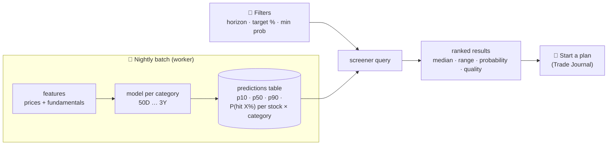

<!-- nav -->[← Previous](15-trade-journal.md) · [🏠 Index](README.md) · [Next →](17-database-backend.md)

# 16 – Holding-Period Screener 🔎

**Purpose:** answer *"If I hold for N days and want X%, which stocks fit?"* and *"For this stock, which holding period is best?"*
Long-term only for now.

## Holding categories
| Category | Calendar days | ≈ Trading days | Tax treatment (India) |
|---|---|---|---|
| 50D | 50 | ~35 | STCG |
| 100D | 100 | ~70 | STCG |
| 200D | 200 | ~140 | STCG |
| 300D | 300 | ~205 | STCG |
| 1Y | 365 | ~250 | **LTCG** (≥ 12 months; hold at least 366 days to be safe) |
| 2Y | 730 | ~500 | LTCG |
| 3Y | 1,095 | ~750 | LTCG |
| 5Y (optional) | 1,825 | ~1,250 | LTCG |

You enter **calendar days**; the system converts them to trading days using the NSE calendar.
Each category has its own model, because what drives a 50-day move (momentum, trend) differs from a 3-year move (fundamentals, valuation).

## Three ways to use it
### 1. Target screener: "50 days, I want 15–25%"
```
Filter: Holding 50D · Target 15–25% · Min probability 35% · Max stop −8% · Quality ≥ 6 · NIFTY 500

Stock      Median  Range (p10–p90)   P(hit 20%)  Quality  Risk    Suggested entry
TATAMOTORS +11%    −7% … +27%        42%         7/10     High    ₹780–795
POLYCAB    +9%     −5% … +22%        38%         9/10     Medium  ₹6,450–6,520
...
```
### 2. Horizon view: "Show expected % for all stocks over 200 days"
A sortable table of median %, range and probability for every stock in the universe.

### 3. Stock view: "For RELIANCE, which holding period is best?"
```
RELIANCE   50D     100D    200D    300D    1Y      2Y      3Y
Median     +3%     +6%     +10%    +13%    +15%    +29%    +44%
Range      ±9%     ±13%    ±18%    ±21%    ±23%    ±32%    ±40%
P(+20%)    8%      18%     31%     39%     43%     68%     81%
Best risk-adjusted: 1Y (LTCG)
```

**Display rule (Q4):** headline = median % with range + probability of the target; the **CAGR** row is shown only for 1Y, 2Y and 3Y ([01](01-overview.md#percentage-outputs-where-each-is-shown)).

## Filter inputs
Any data point from [21 – Stock Analysis Data Points 🧮](21-stock-analysis-datapoints.md) can also be used as a filter (e.g., ROCE > 20%, pledge = 0%).

| Filter | Example |
|---|---|
| Holding category | 50D / 100D / 200D / 300D / 1Y / 2Y / 3Y |
| Target % (single value or range) | 20%, or 15–25% |
| Minimum probability of hitting the target | ≥ 35% |
| Maximum stop-loss | −8% |
| Minimum quality score | ≥ 6/10 |
| Universe / sector / market cap | NIFTY 500, IT, large cap |
| Exchange | NSE (BSE optional) |

## How it works

- All predictions are computed **nightly** for every stock × category and stored, so the screener is just a fast database query.
- The probability of hitting X% is computed for a grid of targets (5, 10, 15, 20, 25, 30, 40, 50%), and the requested target is interpolated from it.

## Related
- [15 – Trade Journal (Manual Tracking) 📒](15-trade-journal.md)
- [03 – Long-Term Analyzer 🔵](03-long-term-analyzer.md)
- [18 – Methods, Accuracy & References 📐](18-methods-accuracy-references.md)
- [🏠 Index](README.md)

---
<!-- nav -->[← Previous](15-trade-journal.md) · [🏠 Index](README.md) · [Next →](17-database-backend.md)
