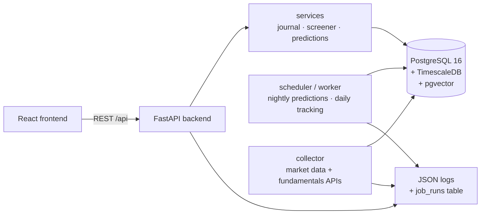
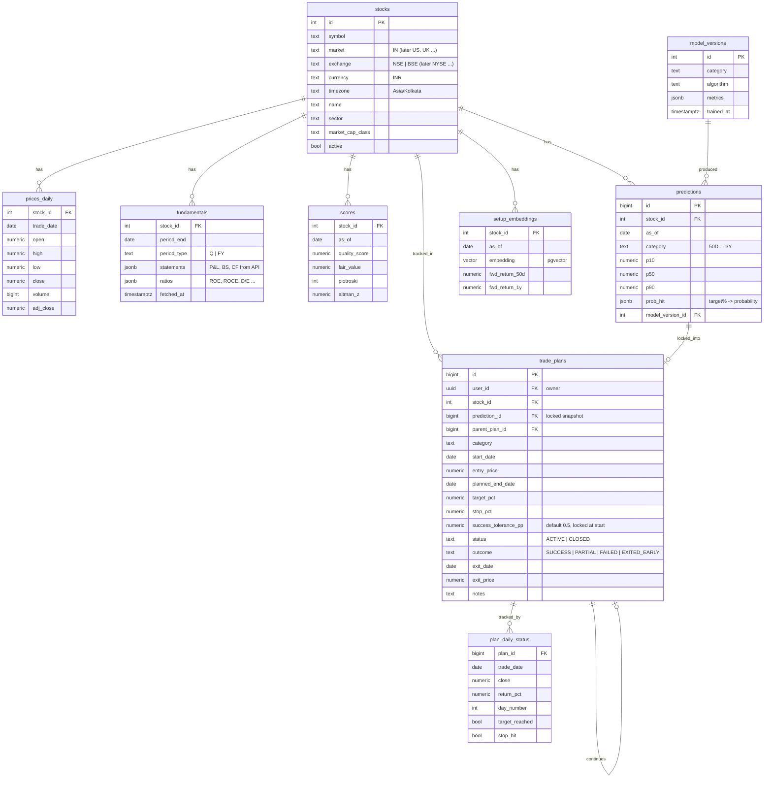

<!-- nav -->[← Previous](16-holding-period-screener.md) · [🏠 Index](README.md) · [Next →](18-methods-accuracy-references.md)

# 17 – Database & Backend Design 🗄️

**Purpose:** the backend technologies and the tables needed for the long-term engine, the screener and the trade journal.

## ✅ Technology choices
| Layer | Choice | Why |
|---|---|---|
| Database | **PostgreSQL 16** | One database for everything; reliable, free |
| Time series | **TimescaleDB** extension (full build, not `-oss`) | Fast queries on years of daily prices; hypertables |
| Vector search | **pgvector** extension (inside the same Postgres) | Find "similar past setups" (historical analogs); speed isn't critical, so no separate vector DB is needed |
| Backend API | **FastAPI** | Clean REST API between the UI and the engines |
| ORM / migrations | SQLAlchemy 2 (async) + **asyncpg** + Alembic | Versioned schema changes |
| Jobs | APScheduler (or Celery + Redis) | Nightly predictions, daily tracking |
| UI | **React + TypeScript (Vite)** calling FastAPI | See [23 – Frontend (React) & Backend Split 🖥️](23-frontend-react.md) |
| Auth | **OAuth 2.0 / OIDC** (Google, Microsoft) via Authlib in FastAPI |
| Logs & telemetry | **OpenTelemetry** (traces, metrics, logs) → Grafana `otel-lgtm`, + `job_runs` table | Debugging, performance and audit |

## Data model

Provider tables (`providers`, `provider_credentials`, `provider_assignments`, `provider_health`, `provider_coverage`, `provider_changes`) are in [22 – Data Provider Configuration (In-App UI) ⚙️](22-provider-configuration-ui.md).

User tables (`users`, `watchlists`, `user_settings`, `audit_log`) are in [19 – Authentication (OAuth) & Multi-User 🔐](19-auth-multi-user.md).

ML tables (`features_daily`, `model_versions` status `CANDIDATE` / `ACTIVE` / `RETIRED`, `predictions`) are explained in [26 – ML Pipeline & Model Operations 🤖](26-ml-pipeline.md).

Other tables: `job_runs` (every scheduled job, its status and duration), `daily_returns` (EOD report),
`holidays` (NSE calendar), `app_settings`.

## What pgvector is used for
Each stock-day is turned into a numeric **feature vector** (momentum, volatility, valuation, quality, trend …).
For a new setup, the app finds the **most similar past setups** and shows what happened next:
*"In 62 similar setups, the median 50-day return was +8%, and 34% reached +20%."*
This is a classic, explainable method (k-nearest neighbours) and doubles as a sanity check on the ML models.

## Logging
- Every service writes **JSON logs** (timestamp, service, job, stock, level, message)
- `job_runs` records each job: start, end, status, rows processed, error
- Prediction runs log the `model_version_id`, so every number can be traced back to the model that made it
- If a problem needs investigating, share the relevant logs or `job_runs` rows

## Related
- [07 – Architecture & Tech Stack](07-architecture.md)
- [14 – Docker Deployment & 24/7 Operation 🐳](14-docker-deployment.md)
- [15 – Trade Journal (Manual Tracking) 📒](15-trade-journal.md)
- [🏠 Index](README.md)

---
<!-- nav -->[← Previous](16-holding-period-screener.md) · [🏠 Index](README.md) · [Next →](18-methods-accuracy-references.md)
