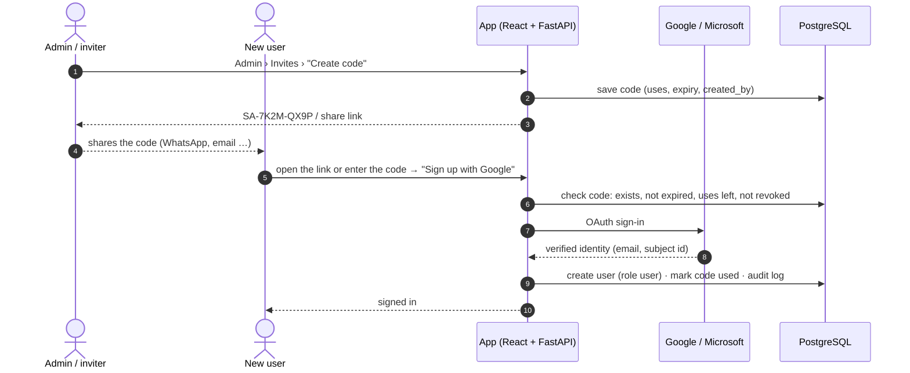
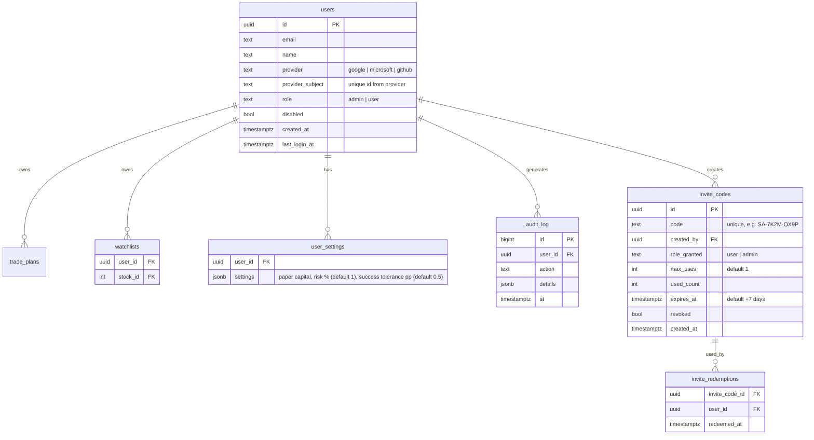

<!-- nav -->[← Previous](18-methods-accuracy-references.md) · [🏠 Index](README.md) · [Next →](20-environments-dev-test-prod.md)

# 19 – Authentication (OAuth) & Multi-User 🔐

**Purpose:** let you **and other users** sign in safely with OAuth, keep each user's plans private, and cover what changes
when the app is no longer personal-only.


> **Status (2026-11-01, Phase 5b):** built. Every API needs a session except health and sign-in.
> Google / Microsoft appear on the sign-in page once their OAuth client id and secret are in `.env`
> (redirect URI `{SA_PUBLIC_URL}/api/auth/callback/google|microsoft`). Until then use the dev-only
> sign-in (`SA_DEV_LOGIN=true`, refused in prod). Sessions in the database (Q71), OIDC + PKCE with
> JWKS verification (Q72), plans from before accounts claimed by the first admin (Q73).
> Admin › Users: invite codes, disable / enable, audit log. Account › Delete my account.

## ✅ Decision
A pet project for personal use **and other users**. Sign-in uses **OAuth 2.0 / OpenID Connect (OIDC)**, with no passwords stored by the app.

## Sign-in providers
| Provider | Why |
|---|---|
| **Google** | Most users already have an account |
| **Microsoft** (Outlook / personal accounts) | Second common option |
| GitHub (optional) | For developer users |

## Approach options
| Option | What runs | Maintenance | Fit |
|---|---|---|---|
| **A. Direct OIDC in FastAPI** (Authlib) | Nothing extra; FastAPI talks to Google/Microsoft | ✅ Lowest | **Recommended** (matches "don't maintain things") |
| B. Managed auth service (Auth0, Clerk, Supabase Auth) | Hosted by the vendor | Low | Good if you later want email login, MFA dashboards; free tiers have user limits |
| C. Self-hosted identity server (Keycloak, Authentik) | Extra container + its own database | ❌ High | Overkill for this project |

## Login flow (OIDC Authorization Code + PKCE)
```mermaid
sequenceDiagram
    autonumber
    actor U as User
    participant UI as React app
    participant API as FastAPI backend
    participant IDP as Google / Microsoft
    participant DB as PostgreSQL

    U->>UI: Click "Sign in with Google"
    UI->>API: /auth/login?provider=google
    API->>IDP: redirect (client_id, scope=openid email profile, PKCE, state)
    U->>IDP: Approve sign-in
    IDP->>API: /auth/callback?code=...
    API->>IDP: exchange code (+ PKCE verifier) for ID token
    API->>API: verify ID token signature, issuer, audience, nonce
    API->>DB: find or create user (by provider + subject id)
    API->>UI: secure session cookie (HttpOnly, Secure, SameSite)
    UI->>API: requests carry the session; API checks user & role
```

## Roles & data separation
| Role | Can do |
|---|---|
| **admin** (you) | Everything: manage users, **data providers** ([22](22-provider-configuration-ui.md)), model runs, settings, view logs |
| **user** | Own trade journal, screener, own reports |
| (disabled) | Blocked by an admin (e.g., misuse); can't sign in |

- ✅ **Sign-up via OAuth + invite code:** a new person signs in with Google or Microsoft **and enters an invite code** that someone shared with them; the account (role **user**) is created only if the code is valid
- Existing users sign in with OAuth only (the code is needed once, at sign-up)
- **Sign-up mode** is an admin setting: `INVITE_CODE` (default) or `OPEN` (anyone with Google/Microsoft can join)
- **The first admin** is set by `SA_ADMIN_EMAILS` in `.env`: that email gets the **admin** role on first sign-in
- Admins can **disable** an account at any time
- Abuse protection: rate limits on sign-in and API calls; per-user limits on plans and screener queries
- Every user-owned table has `user_id`; every query filters by the signed-in user
- Shared data (prices, fundamentals, predictions) is computed once and read by everyone

## Invite codes
| Rule | Default |
|---|---|
| Who can create codes | Admins; optionally users (admin setting, off by default) |
| Format | Short readable code, e.g., `SA-7K2M-QX9P` (or a shareable link `…/signup?code=SA-7K2M-QX9P`) |
| Uses per code | Configurable: single-use (default) or N uses |
| Expiry | Configurable: 7 days (default) |
| Role given | `user` (only admins can create codes that grant `admin`) |
| Revoke | Admin can revoke unused codes at any time |
| Tracking | Who created it, who used it, when (shown in Admin › Users) |


Invalid, expired or used-up codes show a clear message and **no account is created**.

## Database additions

`trade_plans` gets a `user_id` column (see [17 – Database & Backend Design 🗄️](17-database-backend.md)).

## Exposing the app to other users
✅ **Not required.** The app is accessed locally only.
If remote access (or access for other users) is ever needed, the solution will be **deployed to a hosted server**
(e.g., a cloud Linux VM) using the same Docker images and the prod compose file ([20](20-environments-dev-test-prod.md)),
with HTTPS on a domain. The home machine is never exposed to the internet.

OAuth redirect URLs then use that HTTPS domain (e.g., `https://stocks.<your-domain>/auth/callback`). Until then, OAuth uses `http://localhost`.

## Security checklist
- Client IDs and secrets in `.env`, never in git
- Validate `state`, `nonce` and PKCE; verify ID token signatures via the provider's JWKS
- HttpOnly + Secure + SameSite cookies; short session lifetime with refresh
- Rate-limit the login and API endpoints
- Audit log of sign-ins and admin actions
- Users can delete their account and data

## ⚠️ What changes with other users
| Topic | Personal only | With other users |
|---|---|---|
| **Market data licence** | Your data API key, personal use: fine | Showing personal-plan API prices to others counts as **redistribution**, which personal API terms usually forbid. Options: buy a data plan that allows display to other users, or a **redistribution licence** from an authorized NSE data vendor |
| **Invite codes** | n/a | Only people you share a code with can join, which keeps the group small and known (helps with the SEBI, licence and privacy points below). If the mode is switched to `OPEN`, those points apply fully |
| **SEBI** | Fine | Buy/sell or "hold N days → X%" recommendations to others can require **SEBI Research Analyst registration**, especially if paid. Keep it invite-only, free and clearly "educational, not advice", and get advice before going public |
| **Privacy (DPDP Act 2023)** | n/a | Store only the necessary personal data (email, name), publish a privacy notice, allow deletion |

## Related
- [17 – Database & Backend Design 🗄️](17-database-backend.md)
- [14 – Docker Deployment & 24/7 Operation 🐳](14-docker-deployment.md)
- [08 – Non-Functional Requirements](08-non-functional.md)
- [🏠 Index](README.md)

---
<!-- nav -->[← Previous](18-methods-accuracy-references.md) · [🏠 Index](README.md) · [Next →](20-environments-dev-test-prod.md)
