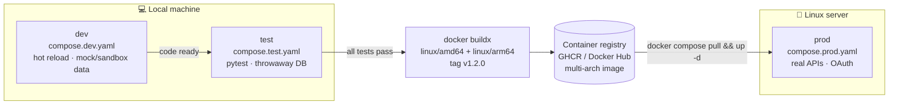

<!-- nav -->[← Previous](19-auth-multi-user.md) · [🏠 Index](README.md) · [Next →](21-stock-analysis-datapoints.md)

# 20 – Environments: Dev, Test & Prod 🧪

**Purpose:** develop and test everything **locally in Docker**, then move the same images to a **Linux production server** later.

## ✅ Decision
| Environment | Where | Runs on |
|---|---|---|
| **dev** | Your local machine: **Linux, macOS or Windows + WSL2** | Docker Engine / Docker Desktop |
| **test** | **Local only** (no CI), containerized | Docker Compose, throwaway containers |
| **prod** | Linux server recommended (later); macOS or Windows + WSL2 also possible | Docker Engine + Docker Compose |

Same Dockerfile and the same images everywhere. Only the **config** (`.env` + compose override) changes.

## Promotion flow


## Compose file layout
```
compose.yaml            # base: all services, shared settings
compose.dev.yaml        # dev overrides: source mounted, hot reload, debug logs, ports open
compose.test.yaml       # test: throwaway db (tmpfs), test runner container
compose.prod.yaml       # prod: pinned image tags, restart policies, resource limits
.env.example            # template (committed)
.env.dev / .env.test    # local only (not committed)
.env.prod               # only on the prod server (not committed)
Dockerfile              # one multi-stage Dockerfile (base → dev → prod targets)
```
Commands:
```bash
# dev
docker compose -f compose.yaml -f compose.dev.yaml --env-file .env.dev up
# test
docker compose -f compose.yaml -f compose.test.yaml --env-file .env.test run --rm tests
# prod (on the Linux server)
docker compose -f compose.yaml -f compose.prod.yaml --env-file .env.prod up -d
```
A `Makefile` wraps these:
| Target | What it does |
|---|---|
| `make bootstrap` | Fresh clone: `.env` with generated secrets, dev db + Redis, migrations ([scripts/bootstrap-dev.sh](../scripts/bootstrap-dev.sh)) |
| `make dev-db` / `dev-db-stop` | Start / stop the dev database + Redis (`compose.devdata.yaml`, own compose project) |
| `make dev` | api + web + telemetry (Grafana) with hot reload; starts `dev-db` first |
| `make dev-file` | Same, but telemetry goes to `./telemetry/*.jsonl` (no Grafana) |
| `make dev-data` | Same as dev, plus compose's own `db` + `redis` (profile `data`) |
| `make infra` | Only db + redis + telemetry (to run api/web from VS Code) |
| `make db-*` | `db-upgrade`, `db-downgrade`, `db-revision m="…"`, `db-current`, `db-history`, `db-shell`, `db-reset` (dev only) ([17](17-database-backend.md#database-change-control)) |
| `make redis-*` | `redis-shell`, `redis-info`, `redis-keys p="…"`, `redis-flush` (dev only) |
| `make test` / `make lint` | pytest + Vitest / ruff, mypy, import-linter, ESLint in containers |
| `make down`, `make logs`, `make prod`, `make api-client`, `make format`, `make setup` | Stop, logs, production stack, regenerate the TS client, format, local install |

Images are pinned: `timescale/timescaledb-ha:pg16.15-ts2.31.0` (full build, never `-oss`) and `redis:7.4.12-alpine3.21`.
Compose **projects** are separate, so they never replace each other's containers: `stock-analyzer` (app: api, web, telemetry), `stock-analyzer-devdata` (dev db + Redis), `stock-analyzer-test` (tests).
Compose **profiles**: `data` (db + redis) and `telemetry` (Grafana `otel-lgtm`). Current dev setup details: [25](25-infrastructure-services-inventory.md#current-local-dev-setup-verified-2026-10-31).

## Differences per environment
| Setting | dev | test | prod |
|---|---|---|---|
| Source code | Mounted, hot reload | Built into the image | Built into the image (pinned tag) |
| Market data (configured in the admin UI, [22](22-provider-configuration-ui.md)) | **Recorded fixtures / mock provider**, or the broker sandbox, to save rate limits | Fixtures only (deterministic) | Real broker + fundamentals APIs |
| Database | Local volume + seed data (NIFTY 50, 2 years) | Throwaway (tmpfs), recreated per run | Persistent volume + nightly backups |
| OAuth | Separate OAuth client, redirect `http://localhost:5173/api/auth/callback` | Auth mocked | Production OAuth client, `https://` domain |
| Scheduler | Manual trigger (or fast-forwarded clock) | Disabled; jobs called directly | Full 24/7 IST schedule |
| Notifications | Logged to console | Off | In-app (WhatsApp later) |
| Logs | Debug, readable | Debug | Info, JSON, rotated |
| Exposure | localhost only | none | Local network only (if remote access is needed: deploy to a hosted server) |
| LLM add-on (optional) | Off, or native Ollama on Apple Silicon (`host.docker.internal`) | Off | Off, or `ollama` container on the NVIDIA GPU |

## Testing strategy
| Level | What | Tool |
|---|---|---|
| Unit | Indicators, scores, fair value, return/tax maths | pytest |
| Data leakage | No future data in features or labels (purged splits) | pytest custom checks |
| Integration | API ↔ database ↔ jobs with fixture data | pytest + test compose |
| Provider contract | Market data / fundamentals responses still match the expected shape | Recorded fixtures (`vcrpy` / `respx`) |
| Backtest regression | Model metrics don't silently get worse | Saved baseline metrics |
| UI smoke | Login, journal, screener pages load | Playwright (optional) |

## Supported host platforms
✅ All three are supported. The app always runs in **Linux containers**, so it behaves the same on every host.

| | 🐧 Linux | 🍎 macOS (Apple Silicon / Intel) | 🪟 Windows + WSL2 |
|---|---|---|---|
| Docker | Docker Engine + Compose plugin | Docker Desktop (or OrbStack / Colima) | Docker Desktop with the **WSL2 backend** |
| Where to keep the code | Anywhere | Anywhere | **Inside the WSL2 filesystem** (`~/projects/...`), not `C:\`. File access from `/mnt/c` is much slower |
| Run commands from | Terminal | Terminal | WSL2 terminal (Ubuntu) |
| Image architecture | amd64 or arm64 | arm64 (Apple Silicon) / amd64 (Intel) | amd64 |
| Local LLM GPU | NVIDIA via Container Toolkit | Native Ollama (Metal), outside Docker | NVIDIA via Docker Desktop's WSL2 GPU support, or native Ollama for Windows |
| 24/7 suitability | ✅ Best for prod | OK (disable sleep) | OK (disable sleep; Windows updates can force reboots) |
| Start on boot | `systemctl enable docker` | Docker Desktop "start at login" | Docker Desktop "start at login" + auto login, or a WSL2 boot task |

### Cross-platform rules
- `.gitattributes` with `* text=auto eol=lf`, so shell scripts and config files keep Linux line endings on Windows
- Use a `Makefile` (on Windows, run it inside WSL2) instead of OS-specific scripts
- No host paths in the code: everything is configured through `.env` and Docker volumes
- Use named Docker volumes for the database (not bind mounts), to avoid file-permission and speed problems on macOS and Windows
- Multi-arch images (amd64 + arm64) are built and tested locally with `docker buildx` before a release

## Linux support
- All images are **Linux containers**: `python:3.12-slim` (Debian) base
- **Multi-arch builds** with `docker buildx` (`linux/amd64` for most servers, `linux/arm64` for Apple Silicon dev and ARM servers)
- No macOS-only tools in the containers; paths, line endings (LF) and file permissions set for Linux
- Run containers as a non-root user
- Timezone set in containers (`TZ=Asia/Kolkata`), independent of the host

## Production Linux server (later)
| Item | Recommendation |
|---|---|
| OS | **Ubuntu Server 24.04 LTS** (or Debian 12) |
| Docker | Docker Engine + Compose plugin (not Docker Desktop) |
| Start on boot | `systemctl enable docker`; services use `restart: unless-stopped` |
| Firewall | `ufw`: deny incoming by default (only HTTPS 443 if deployed to a hosted server); SSH by key only |
| Updates | `unattended-upgrades` for security patches |
| Backups | Nightly `pg_dump` to a second disk + an off-site copy |
| Monitoring | Health checks + in-app heartbeat alerts; optional Uptime Kuma (its own alerts) |
| GPU (optional) | NVIDIA GPU + NVIDIA Container Toolkit, if the local LLM is enabled |
| Hardware | See [14 – Docker Deployment & 24/7 Operation 🐳](14-docker-deployment.md) |

## Deploying to prod (when ready)
1. Tag a release after the tests pass (`v1.0.0`) → `docker buildx build --platform linux/amd64,linux/arm64 --push`
2. On the server: `git pull` (compose files only) → `docker compose pull`
3. Run database migrations: `docker compose run --rm api alembic upgrade head`
4. `docker compose up -d` → check health checks and the dashboard
5. **Rollback:** set the previous image tag in `.env.prod` and `docker compose up -d`

## Data rules between environments
- **Never copy production user data** (users, trade plans) into dev or test
- Dev uses seed data + fixtures; price history can be exported from prod (market data only) if needed
- Separate secrets per environment: OAuth clients, data API keys, (later) WhatsApp API tokens

## Related
- [14 – Docker Deployment & 24/7 Operation 🐳](14-docker-deployment.md)
- [19 – Authentication (OAuth) & Multi-User 🔐](19-auth-multi-user.md)
- [05 – Models & Evaluation](05-models-and-evaluation.md)
- [🏠 Index](README.md)

---
<!-- nav -->[← Previous](19-auth-multi-user.md) · [🏠 Index](README.md) · [Next →](21-stock-analysis-datapoints.md)
