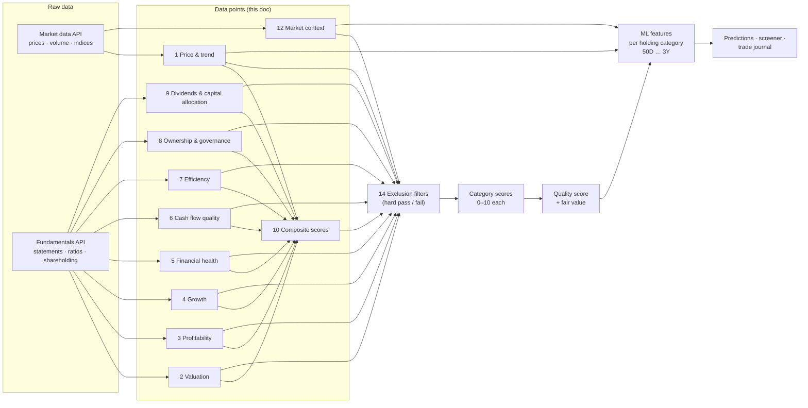

<!-- nav -->[← Previous](20-environments-dev-test-prod.md) · [🏠 Index](README.md) · [Next →](22-provider-configuration-ui.md)

# 21 – Stock Analysis Data Points 🧮

**Purpose:** the complete checklist of data points evaluated for every stock, with the formula, a starting "good" threshold,
the red flags, and where each value comes from. This is the **core of the analysis**: the scores, models and screener are all built from these.

> 🔬 **Status: DRAFT, under deep research.** Every data point, formula, threshold and weight here is a proposal until it has been researched and marked ✅ in the [Research tracker](#research-tracker).

> Thresholds are **starting points** from common Indian-market practice. Backtests will tune them (see [18 – Methods, Accuracy & References 📐](18-methods-accuracy-references.md)).
> Source: **B** = market data API (prices) · **F** = Fundamentals API · **C** = computed by us from B/F.

## How the data points are used


## 1. Price & trend (technical)
| Data point | Formula / definition | Good | Red flag | Src |
|---|---|---|---|---|
| Price vs 50 / 200-DMA | Close ÷ moving average − 1 | Above both; 50-DMA > 200-DMA | Below 200-DMA, falling | C |
| Golden / death cross | 50-DMA crossing the 200-DMA | Golden cross recently | Death cross | C |
| Distance from 52-week high / low | Close ÷ 52w high − 1 | Within 15% of the high | > 40% below the high | C |
| Momentum 3M / 6M / 12-1M | Return over the period (12-1 skips the last month) | Positive, top 30% of the universe | Negative on all | C |
| Relative strength vs NIFTY / sector | Stock return − index return | Beating both | Lagging both | C |
| Volatility (annualised) | Std. dev. of daily returns × √252 | < 30% | > 50% | C |
| ATR % | Average true range ÷ price | Used for stop-loss sizing | — | C |
| Max drawdown (1Y / 3Y) | Largest peak-to-trough fall | < 30% | > 50% | C |
| Beta | Covariance with NIFTY ÷ NIFTY variance | 0.7 – 1.2 | > 1.5 | C |
| Volume trend | 20-day avg volume ÷ 100-day avg | Rising on up days | Rising on down days | C |
| Delivery % | Delivered qty ÷ traded qty | > 50% (genuine buying) | < 25% (speculative) | ⚠️ check API coverage |

## 2. Valuation
| Data point | Formula | Good | Red flag | Src |
|---|---|---|---|---|
| P/E | Price ÷ EPS (TTM) | Below its 5-year median and the sector | Far above both | F/C |
| P/E vs 5-year median | Current P/E ÷ 5y median P/E | < 1.0 | > 1.5 | C |
| PEG | P/E ÷ EPS growth % (3–5y) | < 1.0 – 1.5 | > 2.5 | C |
| P/B | Price ÷ book value per share | Sector-relative (key for banks) | Very high with low ROE | F |
| EV/EBITDA | (Market cap + debt − cash) ÷ EBITDA | < sector median | Far above | F/C |
| Price / Sales | Market cap ÷ revenue | For loss-makers / cyclicals | — | C |
| Earnings yield | EBIT ÷ EV | > 10-year G-sec yield | Below it | C |
| FCF yield | Free cash flow ÷ market cap | > 4% | Negative | C |
| Dividend yield | DPS ÷ price | > 1.5% (bonus point) | — | F |
| Graham number | √(22.5 × EPS × BVPS) | Price below it | Price far above | C |
| DCF fair value | Discounted future FCF (base / bull / bear) | Margin of safety ≥ 20% | Price above the bull case | C |

## 3. Profitability
| Data point | Formula | Good | Red flag | Src |
|---|---|---|---|---|
| ROE | Net profit ÷ avg equity | > 15%, stable 5y | < 10% or falling | F |
| ROCE | EBIT ÷ (equity + debt) | > 15% (> 20% excellent) | < 10% | F |
| ROA | Net profit ÷ total assets | > 8% (non-financials) | < 3% | F |
| Operating margin (OPM) | EBITDA ÷ revenue | Stable or rising | Falling 3+ years | F |
| Net profit margin | Net profit ÷ revenue | Sector-relative, stable | Volatile, falling | F |
| ROE vs ROCE gap | ROE − ROCE | Small | ROE ≫ ROCE (boosted by debt) | C |

## 4. Growth
| Data point | Formula | Good | Red flag | Src |
|---|---|---|---|---|
| Revenue CAGR 3Y / 5Y / 10Y | (End ÷ start)^(1/n) − 1 | > 12% | < inflation (~5%) | C |
| EPS / net profit CAGR 3Y / 5Y | Same | > 15% | Negative | C |
| Quarterly YoY growth (sales, profit) | This quarter vs same quarter last year | Positive, accelerating | 2+ negative quarters | F/C |
| Growth consistency | Number of years with positive growth (out of 10) | ≥ 8 | ≤ 5 | C |
| Profit growth vs revenue growth | Profit CAGR − revenue CAGR | Positive (operating leverage) | Profit growing without revenue | C |

## 5. Financial health
| Data point | Formula | Good | Red flag | Src |
|---|---|---|---|---|
| Debt / equity | Total debt ÷ equity | < 0.5 (0 = debt-free) | > 1.5 (non-financials) | F |
| Interest coverage | EBIT ÷ interest | > 5 | < 2 | F/C |
| Net debt / EBITDA | (Debt − cash) ÷ EBITDA | < 1.5 | > 3.5 | C |
| Current ratio | Current assets ÷ current liabilities | > 1.5 | < 1.0 | F |
| Quick ratio | (Current assets − inventory) ÷ current liabilities | > 1.0 | < 0.7 | C |
| Contingent liabilities | ÷ net worth | < 10% | > 30% | F (if available) |

## 6. Cash flow quality
| Data point | Formula | Good | Red flag | Src |
|---|---|---|---|---|
| Cash conversion | Operating cash flow ÷ net profit (5y sum) | > 0.8 | < 0.5 (profits not turning into cash) | C |
| Free cash flow | Operating CF − capex | Positive in ≥ 4 of 5 years | Negative most years | C |
| Capex intensity | Capex ÷ revenue | Stable, funded by CFO | Funded by debt | C |
| Accruals ratio | (Net profit − CFO) ÷ total assets | Low | High (earnings quality risk) | C |

## 7. Efficiency
| Data point | Formula | Good | Red flag | Src |
|---|---|---|---|---|
| Debtor days | Receivables ÷ revenue × 365 | Stable or falling | Rising fast | F/C |
| Inventory days | Inventory ÷ COGS × 365 | Stable or falling | Rising fast | F/C |
| Cash conversion cycle | Debtor days + inventory days − payable days | Falling | Rising | C |
| Asset turnover | Revenue ÷ total assets | Rising | Falling | C |

## 8. Ownership & governance (critical in India)
| Data point | Definition | Good | Red flag | Src |
|---|---|---|---|---|
| Promoter holding % | Quarterly shareholding pattern | > 50%, stable or rising | Falling steadily | F |
| **Promoter pledge %** | Pledged shares ÷ promoter shares | **0%** | **> 10%**; any increase | F (⚠️ check coverage) |
| FII / DII holding trend | Change over 4 quarters | Rising | Sharp exits | F |
| Number of shareholders | Trend | Stable | Sudden jump (retail pile-in) | F |
| Equity dilution | Share count change per year | ≤ 0% | > 5% a year | C |
| Auditor resignation / qualification | Announcements | None | Any | ⚠️ manual / announcements |
| Related-party transactions | ÷ revenue | Low | High | ⚠️ annual report |
| SEBI / exchange action | Orders, penalties | None | Any | ⚠️ announcements |

## 9. Dividends & capital allocation
| Data point | Formula | Good | Red flag | Src |
|---|---|---|---|---|
| Dividend payout | Dividends ÷ net profit | 20–60%, consistent | > 100% (paying from reserves) | F/C |
| Dividend consistency | Years paid out of 10 | ≥ 8 | Erratic | F |
| Buybacks | Shares bought back | Bonus point | — | F |
| Reinvestment quality | ROCE stays high as capital grows | Yes | ROCE falls as capital grows | C |

## 10. Composite scores
| Score | What it measures | Good | Red flag |
|---|---|---|---|
| **Piotroski F-Score** (0–9) | Profitability, leverage, efficiency improving | ≥ 7 | ≤ 3 |
| **Altman Z-Score** | Bankruptcy risk | > 3.0 (safe) | < 1.8 (distress) |
| **Beneish M-Score** | Earnings manipulation risk | < −2.22 | > −1.78 |
| Graham / DCF margin of safety | Price vs intrinsic value | ≥ 20% below | Above |

## 11. Sector-specific data points
Some ratios don't work for every sector, so these replace them:
| Sector | Use instead | Good |
|---|---|---|
| **Banks / NBFCs** (ignore D/E, current ratio, ROCE) | Gross NPA %, Net NPA %, Provision coverage, CASA ratio, NIM, Capital adequacy (CAR), Credit cost, ROA, P/B | GNPA < 3%, NNPA < 1%, CAR > 15%, ROA > 1.2%, PCR > 70% |
| **Insurance** | Embedded value, VNB margin, solvency ratio, persistency | Solvency > 150% |
| **IT services** | Revenue growth in USD, deal wins, attrition, utilisation | Attrition falling |
| **Cyclicals** (metals, cement, auto) | Normalised earnings, EV/tonne, capacity utilisation | Use cycle-average P/E |
| **Retail / FMCG** | Same-store growth, volume growth | Volume growth > 5% |

⚠️ Check that the chosen fundamentals API supplies the bank/NBFC fields.

## 12. Market & macro context
| Data point | Why it matters | Src |
|---|---|---|
| NIFTY 50 trend (vs 200-DMA) | Bull / bear regime changes all probabilities | B |
| Sector index trend | Sector tailwind or headwind | B |
| India VIX | Market fear; higher means wider ranges | B |
| RBI repo rate direction | Rates affect valuations and banks | Manual / API |
| FII net flows | Liquidity for large caps | ⚠️ check source |
| USD/INR | Exporters (IT, pharma) vs importers | B / F |

## 13. Events & calendar
| Data point | Why it matters |
|---|---|
| Next results date | Big moves happen around results; avoid entries just before, or widen the range |
| Corporate actions | Splits, bonuses, dividends, rights issues adjust prices |
| **ASM / GSM surveillance lists** (NSE) | Exchange flags for unusual activity: exclude |
| Index inclusion / exclusion | Flow-driven moves |

## 14. Exclusion filters (hard pass / fail before scoring)
| Filter | Starting rule |
|---|---|
| Liquidity | Average daily traded value ≥ ₹5 crore |
| Size | Market cap ≥ ₹1,000 crore (to start) |
| Surveillance | Not in ASM / GSM |
| Pledge | Promoter pledge ≤ 25% |
| Solvency | Positive net worth; Altman Z ≥ 1.8 (non-financials) |
| Data quality | ≥ 5 years of financials, ≥ 2 years of prices |

## Weights by holding category
Short holds depend more on trend; long holds depend more on business quality and valuation.
| Category group | 50D – 100D | 200D – 300D | 1Y – 3Y |
|---|---|---|---|
| 1 Price & trend | **40%** | 25% | 10% |
| 2 Valuation | 15% | 20% | **25%** |
| 3 Profitability + 4 Growth | 15% | 20% | **25%** |
| 5 Health + 6 Cash flow + 7 Efficiency | 10% | 15% | 20% |
| 8 Ownership & governance | 10% | 10% | 10% |
| 12 Market context | 10% | 10% | 10% |

These weights are for the **rule-based score**. The ML models learn their own weights from the same data points,
and the two are compared ([03 – Long-Term Analyzer 🔵](03-long-term-analyzer.md#how-the-two-combine)).

## Stock analysis card (example)
```
RELIANCE · NSE · Oil & Gas / Conglomerate                     Data as of 2026-10-27 (EOD)
───────────────────────────────────────────────────────────────────────────────────────
Trend        8/10  above 50 & 200-DMA · 6M momentum +14% · RS vs NIFTY +6%
Valuation    6/10  P/E 24 (5y median 26) · EV/EBITDA 11 · DCF margin of safety 9%
Profitability 6/10 ROE 9.8% · ROCE 10.5% · OPM stable
Growth       7/10  Sales CAGR 5Y 13% · Profit CAGR 5Y 11%
Health       7/10  D/E 0.41 · Interest cover 6.2
Cash flow    6/10  CFO/PAT 1.1 · FCF positive 3 of 5 years
Ownership    9/10  Promoter 50.3% · Pledge 0% · FII rising
Scores             Piotroski 6 · Altman Z 2.9 · Beneish −2.6
Exclusions   ✅ pass
Quality score 7.0/10   →   best holding category: 1Y (see screener)
```
(Illustrative numbers only.)

## Research tracker
Each group is researched in depth separately. Record the findings here, then update the tables above.

| # | Group | Status | Key questions to research | Findings / decision | Sources |
|---|---|---|---|---|---|
| 1 | Price & trend | 🔬 Researching | Which moving averages and momentum windows work best for NSE at 50D vs 1Y? | | |
| 2 | Valuation | 🔬 Researching | Sector-relative or absolute P/E? DCF assumptions (discount rate, terminal growth) for India? | | |
| 3 | Profitability | 🔬 Researching | ROE/ROCE thresholds per sector? How many years of stability? | | |
| 4 | Growth | 🔬 Researching | Which growth windows predict returns best? How to treat one-off years (e.g., COVID)? | | |
| 5 | Financial health | 🔬 Researching | D/E and coverage limits per sector? | | |
| 6 | Cash flow quality | 🔬 Researching | CFO/PAT window (3y or 5y)? | | |
| 7 | Efficiency | 🔬 Researching | Which working-capital measures matter per sector? | | |
| 8 | Ownership & governance | 🔬 Researching | Pledge limits; how to weight FII/DII changes; governance red-flag sources | | |
| 9 | Dividends & capital allocation | 🔬 Researching | Weight for dividends in a growth-focused score? | | |
| 10 | Composite scores | 🔬 Researching | Do Piotroski / Altman / Beneish work on Indian data? Adjusted cut-offs? | | |
| 11 | Sector-specific | 🔬 Researching | Full field list for banks, NBFCs, insurance, IT, cyclicals | | |
| 12 | Market context | 🔬 Researching | How to define bull/bear regimes for NIFTY | | |
| 13 | Events | 🔬 Researching | Entry rules around results dates | | |
| 14 | Exclusion filters | 🔬 Researching | Final liquidity, size and pledge limits | | |
| — | Weights by holding category | 🔬 Researching | Validate the proposed weights with backtests | | |

**Status values:** 🔬 Researching → 📝 Drafted → 🧪 Backtested → ✅ Validated (use in production) · ❌ Dropped

### Research template (copy for each data point)
```markdown
#### <Data point name>
- **Definition / formula:**
- **Why it matters (hypothesis):**
- **Threshold(s) proposed:** good … / red flag …
- **Sector exceptions:**
- **Data source & availability:** (market data API / fundamentals API field name)
- **Evidence:** studies, books, backtest results
- **Decision:** ✅ use · 🔁 modify · ❌ drop
- **Sources:**
```

## Related
- [03 – Long-Term Analyzer 🔵](03-long-term-analyzer.md)
- [16 – Holding-Period Screener 🔎](16-holding-period-screener.md)
- [04 – Data Sources](04-data-sources.md)
- [🏠 Index](README.md)

---
<!-- nav -->[← Previous](20-environments-dev-test-prod.md) · [🏠 Index](README.md) · [Next →](22-provider-configuration-ui.md)
