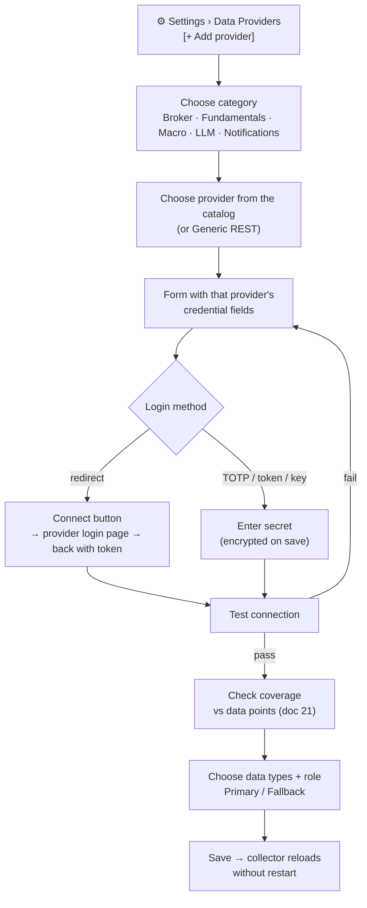
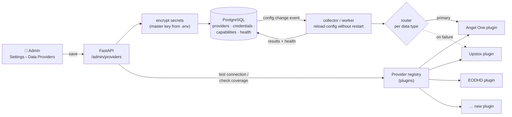
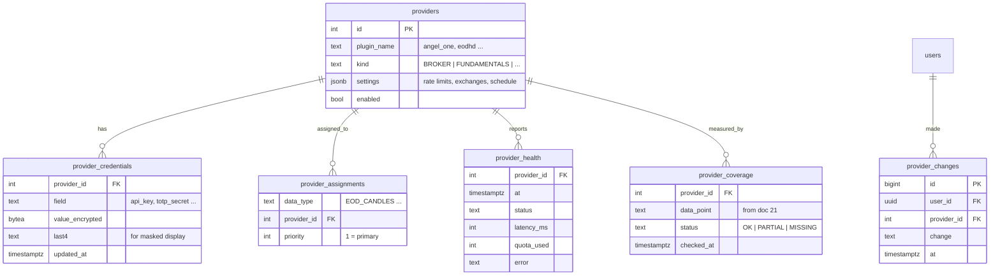

<!-- nav -->[← Previous](21-stock-analysis-datapoints.md) · [🏠 Index](README.md) · [Next →](23-frontend-react.md)

# 22 – Data Provider Configuration (In-App UI) ⚙️

**Purpose:** data providers will change depending on availability, cost and coverage, so the app has an **admin settings screen**
to add, configure, test, prioritise and switch providers **without code changes or restarts**.

## ✅ Decision
- Providers are configured **in the application UI** (admin only), not in `.env` or code
- `.env` keeps only the bootstrap values: database URL and the **master encryption key**
- Every provider is a **plugin** that declares which data it can supply; the UI uses that to show coverage

## What can be configured
| Setting | Example |
|---|---|
| Provider type | Broker (prices) · Fundamentals · Macro · Notifications (later) · LLM (optional) |
| Provider | Angel One, Upstox, Dhan, Kite Connect, Fyers · EODHD, FMP, Trendlyne … |
| Credentials | API key, secret, client ID, TOTP secret, access token (encrypted, masked) |
| Broker login | "Connect" button for redirect logins (Upstox, Kite), or a TOTP secret for automatic daily login (Angel One) |
| Role & priority | **Primary** / **Fallback 1** / **Fallback 2** per data type |
| Data types enabled | EOD candles, hourly quotes, history backfill, fundamentals, shareholding, corporate actions |
| Exchanges | NSE ✅ · BSE (optional) |
| Rate limits | Requests per second / per day (pre-filled from the plugin, editable) |
| Schedule overrides | e.g., hourly snapshot times, fundamentals refresh day |
| Enabled / disabled | Switch a provider off instantly |

## Provider catalog (choices in the "Add provider" dropdown)
Each entry is a built-in plugin. Choosing one shows **its own credential form**, login method and capabilities.
Costs are from public sources (October 2026); verify before subscribing.

### 📈 Market data APIs (prices: EOD candles, hourly snapshots, history, indices) · ✅ used now
| Provider | Credential fields | Data types | Notes |
|---|---|---|---|
| **EODHD** | API token | EOD, delayed/intraday quotes, history, indices | Also supplies fundamentals |
| **Financial Modeling Prep (FMP)** | API key | EOD, quotes, history | Check NSE coverage |
| **TrueData / Global Datafeeds** | Credentials as issued | EOD, intraday, history | Authorized NSE vendors (paid) |

### 🏦 Broker APIs (optional, later; no broker is connected now)
| Provider | Credential fields shown in the form | Login method | Data types | Exchanges | Cost |
|---|---|---|---|---|---|
| **Angel One SmartAPI** | Client code, API key, PIN, TOTP secret | Automatic daily login (TOTP) | EOD, hourly quotes, history, indices | NSE, BSE | Reported free |
| **Upstox API** | API key, API secret, redirect URL | **"Connect Upstox"** button (OAuth redirect), daily token | EOD, hourly quotes, history (daily since 2000) | NSE, BSE | Reported free |
| **Dhan** | Client ID, access token | Long-lived token (no daily login) | EOD, hourly quotes, history | NSE, BSE | Data API ₹499 + tax/month |
| **Zerodha Kite Connect** | API key, API secret | **"Connect Zerodha"** button (redirect), daily token | EOD, hourly quotes, history | NSE, BSE | ₹500/month (Connect plan) |
| **Fyers API** | App ID, secret, redirect URL | **"Connect Fyers"** button, daily token | EOD, hourly quotes, history | NSE, BSE | Check current terms |

### 📚 Fundamentals APIs (Screener-like data)
| Provider | Credential fields | Data types | Notes |
|---|---|---|---|
| **EODHD** | API token | Statements, ratios, shareholding, corporate actions, results calendar | Check NSE small-cap depth |
| **Financial Modeling Prep (FMP)** | API key | Statements, ratios, key metrics | Indian coverage varies |
| **Trendlyne** (data API) | API key / client ID (as issued) | Deep India data incl. shareholding | Business plan on request |
| **Tijori Finance** (data API) | API key (as issued) | Segment-level data | On request |

### 🌐 Macro & other (optional)
| Provider | Credential fields | Use |
|---|---|---|
| RBI / MOSPI data (manual entry or API) | — | Repo rate, CPI |
| **OpenAI** (LLM add-on, optional) | API key, model | Explanations only, never numbers ([10](10-ai-llm-integration.md)) |
| **Local Ollama** (optional) | Base URL, model | Same, on Apple Silicon / NVIDIA |
| **WhatsApp Business (Meta Cloud API)** (later) | Phone number ID, access token, template names | Notifications ([13](13-daily-returns-report.md#notification-channels-later)) |

### 🧪 Development
| Provider | Use |
|---|---|
| **Mock / fixture provider** | Recorded responses for dev and test; no API calls |

### Adding a provider that isn't in the catalog
- **Generic REST provider (advanced):** base URL, auth header, and a field mapping from JSON paths to our data types. Useful for trying a new provider before writing a plugin
- A dedicated plugin is written once the provider is chosen permanently

### "Add provider" flow


## Screens
### 1. Providers list
```
⚙️ Settings › Data Providers                                    [+ Add provider]

Data type          Primary              Fallback            Health
EOD candles        Angel One  ✅         Upstox  ✅           🟢 OK · last run 15:46
Hourly quotes      Angel One  ✅         Upstox  ✅           🟢 OK · 14:15
History backfill   Upstox     ✅         —                   🟢 OK
Fundamentals       EODHD      ✅         FMP  ⚪ disabled     🟡 3 fields missing
Shareholding       EODHD      ✅         —                   🔴 pledge % not supplied
Corporate actions  EODHD      ✅         Angel One  ✅        🟢 OK
```
### 2. Add / edit provider
```
Provider: [ Angel One SmartAPI ▾ ]      Type: Broker      Exchanges: [x] NSE  [ ] BSE
Client ID:     [ A12345        ]
API key:       [ ••••••••••3f9a ]   [Replace]
TOTP secret:   [ ••••••••••••••• ]   [Replace]
Data types:    [x] EOD candles  [x] Hourly quotes  [x] History  [ ] Corporate actions
Rate limit:    [ 3 ] req/sec   [ 5000 ] req/day
Role:          ( ) Primary  (•) Fallback 1  ( ) Fallback 2
[ Test connection ]   [ Check coverage ]   [ Save ]   [ Disable ]
```
### 3. Coverage check
Compares what the provider returns with the data points list in [21 – Stock Analysis Data Points 🧮](21-stock-analysis-datapoints.md):
```
Coverage: EODHD (Fundamentals) · sample: NIFTY 50
✅ P&L, balance sheet, cash flow (10y)      ✅ ROE, ROCE, D/E
✅ Promoter / FII / DII holding              ❌ Promoter pledge %
⚠️ Bank NPA / CASA (partial: 6 of 12 banks) ❌ ASM / GSM lists
Coverage score: 41 / 47 data points (87%)
```
### 4. Health & history
Last success, error rate, average latency, quota used today, recent errors and a change log (who changed what, when).

## How it works


### Automatic failover
1. The collector calls the **primary** provider for a data type
2. On error, timeout or quota exhaustion, it retries with backoff, then moves to **Fallback 1**, then **Fallback 2**
3. Every record stores **which provider supplied it** (`source_provider`), shown next to values in the UI
4. The health screen shows the failover, and an in-app alert is raised

### Provider plugin interface
Each plugin implements a common interface and declares its capabilities:
```python
class ProviderPlugin(Protocol):
    name: str                      # "angel_one"
    kind: ProviderKind             # BROKER | FUNDAMENTALS | MACRO | NOTIFY | LLM
    capabilities: set[DataType]    # {EOD_CANDLES, HOURLY_QUOTES, ...}
    credential_fields: list[Field] # drives the form in the UI
    default_rate_limit: RateLimit

    def test_connection(self, creds) -> TestResult: ...
    def check_coverage(self, creds, sample) -> CoverageReport: ...
    def fetch(self, data_type, request) -> Records: ...
```
Adding a new provider = add one plugin file; it appears in the UI dropdown automatically.

## Database additions


## Security
- **Admin only** (see [19 – Authentication (OAuth) & Multi-User 🔐](19-auth-multi-user.md)); regular users can't see this screen
- Secrets are **encrypted at rest** (AES via `cryptography` Fernet) with the master key from `.env`; the database alone can't reveal them
- Secrets are **write-only** in the UI: shown masked (`••••3f9a`), replaced but never displayed
- Secrets never appear in logs, error messages or API responses
- Every change is written to `provider_changes` (audit trail)
- Backups contain only encrypted secrets; keep the master key in a separate safe place

## Per environment
| | dev | test | prod |
|---|---|---|---|
| Providers | Mock / fixture provider pre-configured; real ones optional | Mock only | Configured by the admin in the UI |
| Master key | Dev key | Test key | Prod key (never reused) |

## Related
- [04 – Data Sources](04-data-sources.md)
- [11 – Live Cloud Data (Actual Values)](11-live-cloud-data.md)
- [21 – Stock Analysis Data Points 🧮](21-stock-analysis-datapoints.md)
- [🏠 Index](README.md)

---
<!-- nav -->[← Previous](21-stock-analysis-datapoints.md) · [🏠 Index](README.md) · [Next →](23-frontend-react.md)
