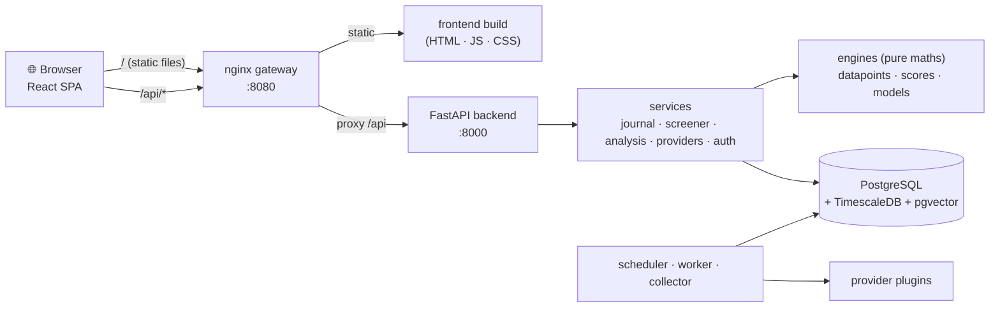

<!-- nav -->[← Previous](22-provider-configuration-ui.md) · [🏠 Index](README.md) · [Next →](24-coding-standards.md)

# 23 – Frontend (React) & Backend Split 🖥️

**Purpose:** the frontend is a **React** app; the backend is **FastAPI**. This doc defines the frontend stack, its pages,
how it talks to the backend, and how it runs in Docker.

## ✅ Decision
| Part | Choice |
|---|---|
| Frontend | **React + TypeScript**, built with **Vite** (single-page app) |
| Backend | **FastAPI** (Python): API, business logic, pure-maths engines, jobs |
| Contract | **REST/JSON**, described by FastAPI's **OpenAPI** schema; the TypeScript API client is **generated** from it |

**Why Vite (SPA) rather than Next.js:** the backend already does authentication, data and logic, so the frontend doesn't need its own server.
A Vite SPA builds to static files served by nginx: one less Node server to run and maintain. (Next.js stays an option if server-side rendering is ever needed.)

## Architecture

Frontend and API are served from the **same origin** (`/` and `/api`), so there is no CORS setup, and login cookies work simply.

## Frontend stack
| Concern | Library |
|---|---|
| Language / build | TypeScript, Vite, Node.js 22 LTS (build only) |
| Routing | React Router |
| Server data, caching | TanStack Query |
| UI components | **shadcn/ui** (Radix UI + Tailwind CSS); light and dark themes |
| Tables (screener, journal, providers) | TanStack Table: sorting, filtering, column choice |
| Forms + validation | React Hook Form + Zod (validation rules shared with the API schema) |
| Price charts | **TradingView Lightweight Charts** (candlesticks, moving averages, plan target/stop lines) |
| Other charts | Recharts (returns, accuracy, distributions) |
| API client | Generated from OpenAPI (`openapi-typescript` + `openapi-fetch`, or Orval) |
| Dates / money | date-fns (IST and other timezones), `Intl.NumberFormat` (₹ lakh/crore formatting, other currencies later) |
| Tests | Vitest + React Testing Library; Playwright for end-to-end |
| Code quality | ESLint, Prettier, TypeScript strict mode |

## Pages
| Route | Page | Phase |
|---|---|---|
| `/admin/providers` | ⚙️ Data Providers: list, add (catalog), edit, test, coverage, health ([22](22-provider-configuration-ui.md)) | 1 |
| `/stocks/:symbol` | 📈 Stock view: price chart + analysis card ([21](21-stock-analysis-datapoints.md)) | 1–3 |
| `/plans`, `/plans/new`, `/plans/:id` | 📒 Trade Journal ([15](15-trade-journal.md)) | 2 |
| `/screener` | 🔎 Holding-Period Screener ([16](16-holding-period-screener.md)) | 4 |
| `/reports` | 📊 Daily Returns Report ([13](13-daily-returns-report.md)) | 6 |
| `/login`, `/signup?code=…`, `/admin/users`, `/admin/invites` | 🔐 Sign-in, sign-up with invite code, 👥 users, 🎟️ invite codes ([19](19-auth-multi-user.md)) | 5b |
| `/settings` | Paper capital, defaults | 2 |

Layout: left sidebar navigation, top bar (market status · data freshness · user), responsive down to tablet and phone widths.

## Backend API (main endpoints)
| Endpoint | Purpose |
|---|---|
| `GET /api/health` | Health check |
| `GET /api/stocks?query=` · `GET /api/stocks/{symbol}` | Search and stock details |
| `GET /api/stocks/{symbol}/prices` | Candles for the chart |
| `GET /api/analysis/{symbol}` | Analysis card (data points, scores) |
| `GET /api/predictions/{symbol}` | Predictions per holding category |
| `POST /api/screener` | Screener query (category, target %, filters) |
| `GET/POST /api/plans` · `PATCH /api/plans/{id}/close` | Trade journal |
| `GET /api/reports/daily?date=` | Daily returns report |
| `GET/POST/PATCH /api/admin/providers` · `POST …/{id}/test` · `POST …/{id}/coverage` | Provider configuration |
| `/api/auth/login` · `/api/auth/callback` · `/api/auth/logout` · `GET /api/me` | OAuth (Phase 5b) |

Versioning: start with `/api/...`; add `/api/v2` only when a breaking change is needed.

## Docker & environments
| | dev | test | prod |
|---|---|---|---|
| Frontend | **Vite dev server** with hot reload (`:5173`), proxies `/api` to the backend | Vitest in a Node container; Playwright against the test stack | **Static build** served by **nginx** (`:8080`), which also proxies `/api` |
| Backend | Uvicorn with `--reload` (`:8000`) | pytest | Uvicorn/Gunicorn workers |
| Open in browser | `http://localhost:5173` | — | `http://<machine-ip>:8080` |

Frontend Dockerfile (multi-stage): `node:22` builds → `nginx:alpine` serves `dist/`.

## Repository layout
```
stock-analyzer/
├── backend/            # FastAPI, Clean Architecture: domain · application · infrastructure · presentation
├── frontend/           # React + TypeScript, feature-based: app · pages · features · shared
├── compose.yaml · compose.dev.yaml · compose.test.yaml · compose.prod.yaml
├── Makefile · .env.example · .gitattributes · .pre-commit-config.yaml
├── CHANGELOG.md
└── docs/               # planning docs, adr/, glossary.md
```
The full backend and frontend folder trees, layer rules and naming conventions are in
[24 – Coding Standards & Clean Architecture 📏](24-coding-standards.md).

## Development workflow
1. Change the backend → FastAPI updates `/openapi.json`
2. `make api-client` regenerates the TypeScript client, so frontend type errors show any API changes immediately
3. `make dev` runs everything with hot reload; `make test` runs pytest + Vitest; `make e2e` runs Playwright

## Related
- [07 – Architecture & Tech Stack](07-architecture.md)
- [17 – Database & Backend Design 🗄️](17-database-backend.md)
- [20 – Environments: Dev, Test & Prod 🧪](20-environments-dev-test-prod.md)
- [🏠 Index](README.md)

---
<!-- nav -->[← Previous](22-provider-configuration-ui.md) · [🏠 Index](README.md) · [Next →](24-coding-standards.md)
