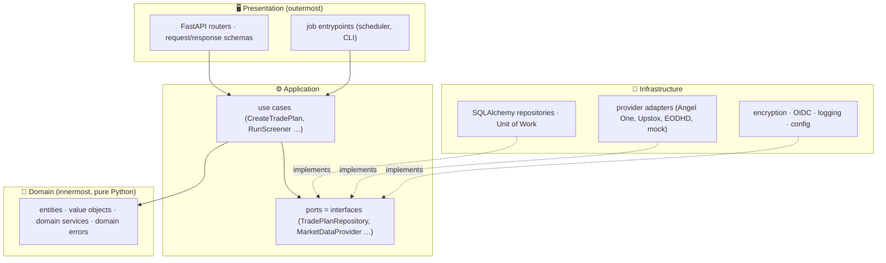

<!-- nav -->[← Previous](23-frontend-react.md) · [🏠 Index](README.md) · [Next →](25-infrastructure-services-inventory.md)

# 24 – Coding Standards & Clean Architecture 📏

**Purpose:** one set of rules so the code stays **clean, consistent and easy for anyone to understand** in the future:
architecture layers, OOP design, naming conventions, file organisation, documentation and quality checks.
These rules apply to **every** change, backend and frontend.

## 1. Principles
| Principle | In practice |
|---|---|
| **Clean Architecture** | Business rules don't depend on frameworks, databases or APIs; those depend on the business rules |
| **SOLID** | Small classes with one responsibility; depend on interfaces, not concrete classes |
| **Separation of concerns** | Maths, business rules, storage, providers and UI live in separate layers |
| **KISS / YAGNI** | The simplest design that meets the current phase; no speculative features |
| **DRY** (with judgement) | Share real duplication; don't merge things that only look alike |
| **Explicit over clever** | Readable names and straightforward code over short tricks |
| **Pure maths stays pure** | Calculations are pure functions/classes: same input → same output, no I/O |

## 2. Backend: Clean Architecture layers

**Dependency rule:** arrows point **inwards only**.
- `domain` imports nothing from the other layers, and nothing from FastAPI, SQLAlchemy or httpx
- `application` imports `domain` only, and defines **ports** (interfaces)
- `infrastructure` implements the ports
- `presentation` calls use cases; it never touches the database or providers directly
- Wiring happens in one place: the **composition root** (`bootstrap.py`)

This is enforced automatically with **import-linter** contracts in `make lint` and the pre-commit hooks.

## 3. Backend folder structure
```
backend/
├── pyproject.toml
├── src/stock_analyzer/
│   ├── domain/                         # 💎 pure business rules, no frameworks
│   │   ├── shared/                     # Money, Percentage, DateRange, base errors
│   │   ├── market/                     # Market, Exchange, TradingCalendar
│   │   ├── stock/                      # Stock (entity), Symbol (value object)
│   │   ├── pricing/                    # Candle, PriceSeries
│   │   ├── fundamentals/               # FinancialStatement, Ratio
│   │   ├── analysis/                   # DataPoint calculators, CategoryScore, QualityScore
│   │   ├── prediction/                 # HoldingCategory, ReturnRange, Prediction
│   │   └── journal/                    # TradePlan (aggregate), PlanStatus, PlanOutcome, rules
│   ├── application/                    # ⚙️ use cases + ports
│   │   ├── ports/                      # repositories.py, providers.py, security.py, clock.py
│   │   ├── use_cases/
│   │   │   ├── journal/                # create_trade_plan.py, close_trade_plan.py
│   │   │   ├── analysis/               # get_stock_analysis.py
│   │   │   ├── screener/               # run_screener.py
│   │   │   ├── providers/              # configure_provider.py, test_provider_connection.py
│   │   │   └── data/                   # backfill_prices.py, take_hourly_snapshot.py
│   │   └── dto/                        # input/output data classes for use cases
│   ├── infrastructure/                 # 🔌 adapters to the outside world
│   │   ├── persistence/
│   │   │   ├── models/                 # SQLAlchemy ORM models (one file per aggregate)
│   │   │   ├── repositories/           # SqlAlchemyTradePlanRepository, …
│   │   │   ├── unit_of_work.py
│   │   │   └── migrations/             # Alembic
│   │   ├── providers/
│   │   │   ├── registry.py             # ProviderRegistry, ProviderRouter (failover)
│   │   │   ├── mock/                   # MockMarketDataProvider (fixtures)
│   │   │   ├── angel_one/              # client.py, mapper.py, provider.py
│   │   │   ├── upstox/
│   │   │   └── eodhd/
│   │   ├── security/                   # FernetSecretCipher, OidcAuthenticator
│   │   ├── scheduling/                 # APScheduler setup
│   │   ├── logging/                    # JSON logging setup
│   │   └── config/                     # Settings (pydantic-settings)
│   ├── presentation/                   # 🖥️ entry points
│   │   ├── api/
│   │   │   ├── routers/                # one router per feature: plans.py, stocks.py, …
│   │   │   ├── schemas/                # Pydantic request/response models per feature
│   │   │   ├── dependencies.py         # FastAPI Depends → use cases
│   │   │   └── error_handlers.py       # domain errors → HTTP responses
│   │   └── jobs/                       # scheduled job entry points
│   ├── bootstrap.py                    # composition root: builds and wires everything
│   └── main.py                         # FastAPI app factory
└── tests/
    ├── unit/                           # domain + application (fast, no I/O)
    ├── integration/                    # repositories, providers (test DB, fixtures)
    ├── e2e/                            # API end-to-end
    └── fixtures/                       # recorded provider responses, sample data
```
**One concept per file.** A file over ~300 lines, or a class over ~200, is a signal to split.

## 4. OOP design
| Pattern | Where | Example |
|---|---|---|
| **Entity** (identity + behaviour) | Domain | `TradePlan` with `close()`, `mark_target_reached()` |
| **Value object** (immutable, compared by value) | Domain | `Money`, `Percentage`, `Symbol`, `ReturnRange` (`@dataclass(frozen=True)`) |
| **Aggregate** (consistency boundary) | Domain | `TradePlan` owns its daily statuses; changes go through it |
| **Domain service** | Domain | `QualityScorer` combining category scores |
| **Strategy** | Analysis | Each data point is a `DataPointCalculator` (`RoceCalculator`, `PiotroskiScoreCalculator`) |
| **Port / Adapter** | Application / Infrastructure | `MarketDataProvider` (port) ← `AngelOneMarketDataProvider` (adapter) |
| **Repository + Unit of Work** | Persistence | `TradePlanRepository`, `SqlAlchemyUnitOfWork` |
| **Factory / Registry** | Providers | `ProviderRegistry.create("angel_one", credentials)` |
| **Template Method** | Model training | `HoldingPeriodModelTrainer.train()` → `prepare_features()`, `label()`, `fit()`, `evaluate()` |
| **Use case (command)** | Application | `CreateTradePlan.execute(request) -> TradePlanDto` |

Rules:
- **Composition over inheritance.** Inheritance only for true "is-a" relationships, at most 2 levels deep
- Business rules live **inside** entities and value objects, not in routers or repositories (no "anaemic" models)
- Interfaces are `abc.ABC` (or `typing.Protocol` for small capabilities); depend on them, not on concrete classes
- Objects are created valid: constructors and factory methods validate and raise domain errors
- No global state or singletons; dependencies are passed in through constructors

### Example: value object, entity, port, use case
```python
# domain/shared/percentage.py
@dataclass(frozen=True, slots=True)
class Percentage:
    """A percentage stored as a decimal fraction (0.20 == 20%)."""
    value: Decimal

    @classmethod
    def from_percent(cls, percent: Decimal | int | float) -> "Percentage":
        return cls(Decimal(str(percent)) / 100)


# domain/journal/trade_plan.py
class TradePlan:
    """One holding plan: one start, one planned end, one exit. Prediction is locked at start."""

    def close(self, exit_date: date, exit_price: Money, outcome: PlanOutcome) -> None:
        if self.status is PlanStatus.CLOSED:
            raise PlanAlreadyClosedError(self.id)
        if exit_date < self.start_date:
            raise InvalidExitDateError(self.id, exit_date)
        self.exit_date, self.exit_price, self.outcome = exit_date, exit_price, outcome
        self.status = PlanStatus.CLOSED


# application/ports/repositories.py
class TradePlanRepository(ABC):
    @abstractmethod
    def get(self, plan_id: TradePlanId) -> TradePlan: ...
    @abstractmethod
    def add(self, plan: TradePlan) -> None: ...


# application/use_cases/journal/close_trade_plan.py
class CloseTradePlan:
    def __init__(self, unit_of_work: UnitOfWork) -> None:
        self._unit_of_work = unit_of_work

    def execute(self, request: CloseTradePlanRequest) -> TradePlanDto:
        with self._unit_of_work as uow:
            plan = uow.trade_plans.get(request.plan_id)
            plan.close(request.exit_date, request.exit_price, request.outcome)
            uow.commit()
            return TradePlanDto.from_entity(plan)
```

## 5. Naming conventions
### Python
| Item | Convention | Example |
|---|---|---|
| Package / module | `snake_case`, singular nouns | `trade_plan.py`, `market_data.py` |
| Class | `PascalCase`, nouns | `TradePlan`, `QualityScorer` |
| Interface (port) | Role name, no `I` prefix | `MarketDataProvider`, `TradePlanRepository` |
| Implementation | Technology/vendor + role | `SqlAlchemyTradePlanRepository`, `UpstoxMarketDataProvider` |
| Use case | Verb + noun, method `execute()` | `CreateTradePlan`, `RunScreener` |
| Use case input / output | `…Request` / `…Dto` | `CreateTradePlanRequest`, `TradePlanDto` |
| API schemas | `…RequestBody` / `…Response` | `CreatePlanRequestBody`, `PlanResponse` |
| Function / method | `snake_case`, verb first | `calculate_roce()`, `fetch_daily_candles()` |
| Variable | `snake_case`, descriptive | `entry_price`, `holding_category` |
| Boolean | `is_` / `has_` / `can_` | `is_target_reached`, `has_pledge_data` |
| Constant | `UPPER_SNAKE_CASE` | `DEFAULT_STOP_LOSS_PCT` |
| Enum | `PascalCase` class, `UPPER_SNAKE` members | `PlanStatus.ACTIVE` |
| Private | Leading `_` | `_build_features()` |
| Errors | `…Error` | `PlanAlreadyClosedError`, `ProviderUnavailableError` |
| Units in names | Suffix when not typed | `target_pct`, `latency_ms`, `holding_days`; money uses `Money` |
| Dates / times | `…_date` (date), `…_at` (timestamp) | `start_date`, `created_at` |
| Tests | `test_<unit>_<scenario>_<expected>` | `test_close_plan_when_already_closed_raises_error` |

Avoid abbreviations except well-known domain terms (`roce`, `pe_ratio`, `eps`, `ohlcv`, `nse`), which are listed in the glossary.

### TypeScript / React
| Item | Convention | Example |
|---|---|---|
| **File names** (all frontend files) | `kebab-case` (same as shadcn/ui) | `trade-plan-table.tsx`, `use-trade-plans.ts`, `format-currency.ts` |
| Component (inside the file) | `PascalCase` | `export function TradePlanTable()` |
| Hook (inside the file) | `useCamelCase` | `export function useTradePlans()` |
| Utility function | `camelCase` | `formatCurrency()` |
| Test file | same name + `.test.ts(x)` | `format-currency.test.ts` |
| Folder | `kebab-case` | `trade-journal/` |
| Types / interfaces | `PascalCase`, no `I` prefix | `TradePlan`, `ScreenerFilters` |
| Props type | `<Component>Props` | `TradePlanTableProps` |
| Constants | `UPPER_SNAKE_CASE` | `HOLDING_CATEGORIES` |
| Event handlers | `handle…` (inside), `on…` (props) | `handleSubmit`, `onPlanClosed` |
| Booleans | `is` / `has` / `can` | `isLoading`, `hasCoverage` |

### Database, API, config, Git
| Item | Convention | Example |
|---|---|---|
| Table | `snake_case`, plural | `trade_plans`, `prices_daily` |
| Column | `snake_case` | `entry_price`, `created_at` |
| Primary / foreign key | `id` / `<singular>_id` | `stock_id`, `user_id` |
| Index / constraint | `ix_<table>_<cols>`, `uq_…`, `fk_…`, `ck_…` | `ix_prices_daily_stock_id_trade_date` |
| API path | `/api/<plural-noun>`, kebab-case | `/api/trade-plans/{plan_id}/close` |
| JSON fields | `snake_case` (same as Python; the TS client is generated) | `holding_category` |
| Environment variables | `UPPER_SNAKE`, prefix `SA_` | `SA_DATABASE_URL`, `SA_MASTER_KEY` |
| Git branch | `type/short-description` | `feature/trade-journal`, `fix/hourly-snapshot-timezone` |
| Commit message | Conventional Commits | `feat(journal): lock prediction when a plan starts` |

## 6. Frontend structure (feature-based)
```
frontend/src/
├── app/                    # app shell: router, providers (QueryClient, theme), layout
├── pages/                  # route-level pages; thin, compose features
├── features/               # one folder per feature, self-contained
│   ├── trade-journal/
│   │   ├── api/            # queries & mutations (TanStack Query) using the generated client
│   │   ├── components/     # trade-plan-table.tsx, close-plan-dialog.tsx
│   │   ├── hooks/          # use-trade-plans.ts
│   │   ├── model/          # types, Zod schemas, pure helpers
│   │   └── index.ts        # public exports of the feature
│   ├── screener/
│   ├── stock-analysis/
│   └── provider-settings/
├── shared/
│   ├── api/                # generated OpenAPI client + fetch setup
│   ├── ui/                 # shadcn/ui-based generic components
│   ├── lib/                # formatCurrency, formatDate (IST), percentage helpers
│   └── config/
└── main.tsx
```
Rules: features import from `shared`, never from each other's internals (only through `index.ts`);
components focus on display; data fetching lives in hooks; no business calculations in the UI (the backend does them).

## 7. Code quality rules
### Python
- Python **3.12**, **type hints everywhere**; **mypy --strict** must pass
- **ruff** for lint + format (line length 100); **import-linter** for layer rules
- Docstrings (Google style) on every public module, class and function: *what* and *why*, not *how*
- Small functions (≤ ~30 lines), ≤ 3–4 parameters (otherwise a parameter object)
- **No magic numbers:** thresholds come from named constants or config (e.g., the data point thresholds in [21](21-stock-analysis-datapoints.md))
- Money and percentages use `Decimal`-based value objects, never floats for money
- Errors: a domain error hierarchy (`DomainError` → `PlanAlreadyClosedError` …); never catch bare `except:`
- Logging through the structured logger only; no `print`; never log secrets
- Timezone-aware datetimes only (`zoneinfo`); store UTC, display in the market's timezone

### TypeScript
- `strict: true`; **no `any`** (use `unknown` + narrowing)
- ESLint (React, hooks, import rules) + Prettier
- Server data only through TanStack Query; no manual `fetch` in components

### Tests
| Layer | Test type | Target coverage |
|---|---|---|
| Domain | Unit (pure, fast) | ≥ 90% |
| Application | Unit with fake ports (in-memory repositories, mock providers) | ≥ 85% |
| Infrastructure | Integration (test DB, recorded fixtures) | Key paths |
| API / UI | End-to-end (pytest + Playwright) | Main user flows |

Test structure: **Arrange – Act – Assert**; one behaviour per test; test files mirror the source tree.

### Automation
- **pre-commit** hooks: ruff, mypy, import-linter, ESLint, Prettier, secret scanning
- `make lint` and `make test` run **in containers** and must pass before every commit (no CI server; everything runs locally)

## 8. Documentation standards
| What | Where | Rule |
|---|---|---|
| Planning & design | `docs/NN-*.md` | Existing doc conventions ([00](00-how-to-plan.md)); Mermaid for diagrams |
| Architecture decisions | `docs/adr/NNNN-title.md` | One **ADR** per significant decision: context, decision, consequences |
| Package overview | `README.md` in `backend/`, `frontend/` and each provider plugin | Purpose, how to run, how to extend |
| Code | Docstrings / TSDoc | Public API of every module |
| API | FastAPI OpenAPI (`/api/docs`) | Every endpoint has a summary, description and examples |
| Glossary | `docs/glossary.md` | Domain terms and allowed abbreviations (ROCE, STCG, ASM …) |
| Changes | `CHANGELOG.md` | Keep a Changelog format, per release |

## 9. Definition of Done (every change)
- [ ] Follows the layer rules and naming conventions
- [ ] Type checks, lint and tests pass (`make lint test`)
- [ ] New logic has unit tests; bugs get a regression test
- [ ] Public code has docstrings; docs / ADR updated if behaviour or design changed
- [ ] No secrets, no magic numbers, no `print`, no commented-out code
- [ ] Runs in Docker (`make dev`)

## Related
- [23 – Frontend (React) & Backend Split 🖥️](23-frontend-react.md)
- [07 – Architecture & Tech Stack](07-architecture.md)
- [17 – Database & Backend Design 🗄️](17-database-backend.md)
- [🏠 Index](README.md)

---
<!-- nav -->[← Previous](23-frontend-react.md) · [🏠 Index](README.md) · [Next →](25-infrastructure-services-inventory.md)
