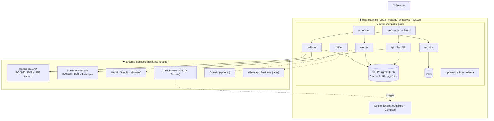

<!-- nav -->[← Previous](24-coding-standards.md) · [🏠 Index](README.md) · [Next →](26-ml-pipeline.md)

# 25 – Infrastructure, Services & Requirements Inventory 🧰

**Purpose:** one place that lists **everything the project needs**: infrastructure, Docker services, external accounts and APIs,
developer tools, ports, volumes, configuration and costs. Use it as the setup checklist for every environment.

## Overview

## 1. Infrastructure
| Item | Dev / test | Prod (later) | Notes |
|---|---|---|---|
| Host OS | macOS, Linux or Windows + WSL2 | **Ubuntu Server 24.04 LTS** (proposed) | [20](20-environments-dev-test-prod.md#supported-host-platforms) |
| CPU / RAM | 4 cores / 8 GB minimum | 8 cores / 16 GB (32 GB with a local LLM) | [14](14-docker-deployment.md#host-machine-requirements) |
| Disk | 50 GB SSD | 200 GB SSD + backup disk | Price history for all NSE stocks is small; models and backups grow |
| GPU (optional) | Apple Silicon (native Ollama) | NVIDIA GPU + NVIDIA Container Toolkit | Only for the LLM add-on |
| Container runtime | Docker Desktop / Rancher Desktop / Docker Engine | Docker Engine + Compose plugin | |
| Network | Local only | Local network; hosted server if remote access is ever needed | No ports exposed to the internet |
| Power | — | UPS recommended; auto-start after power loss | 24/7 operation |
| Backups | Optional | Nightly `pg_dump` → second disk + off-site copy | Master key stored separately |

## 2. Docker services
| Service | Image / build | Role | Port (host) | Depends on | Phase |
|---|---|---|---|---|---|
| `db` (profile `data`) | `timescale/timescaledb-ha:pg16.15-ts2.31.0` (full build, **not** `-oss`: TimescaleDB + pgvector) | Main database | 5432 (dev only) | — | 1 |
| `redis` (profile `data`) | `redis:7.4.12-alpine3.21` | Latest snapshots, job queue | 6379 (dev only) | — | 1 |
| `api` | `./backend` | FastAPI backend | 8000 (dev only) | db, redis | 1 |
| `otel-lgtm` (profile `telemetry`) | `grafana/otel-lgtm:0.8.1` | Grafana + Tempo (traces) + Loki (logs) + Prometheus (metrics) + OpenTelemetry Collector | 3000 (Grafana), 4318 (OTLP, dev) | — | 1 |
| `web` | `./frontend` (Node build → nginx) | React app + `/api` proxy | **8080** (prod) / 5173 (dev, Vite) | api | 1 |
| `scheduler` | `./backend` | Triggers all timed jobs (per market timezone) | — | db, redis | 1 |
| `worker` | `./backend` | Features, predictions, retraining, reports | — | db, redis | 1 |
| `collector` | `./backend` | Calls provider APIs, stores data | — | db | 1 |
| `monitor` | `./backend` | Hourly checks of active plans | — | db, redis | 2 |
| `notifier` | `./backend` | In-app notifications; WhatsApp later | — | db | 6 |
| `migrate` (one-off) | `./backend` | `alembic upgrade head` on deploy | — | db | 1 |
| `tests` (test only) | `./backend`, `./frontend` | pytest, Vitest, Playwright | — | db (tmpfs) | 1 |
| `mlflow` (recommended) | `ghcr.io/mlflow/mlflow` | Experiment tracking + model registry ([26](26-ml-pipeline.md)) | 5000 | db | 3 |
| `ollama` (optional, prod NVIDIA) | `ollama/ollama` | Local LLM | 11434 (internal) | — | later |

Image versions are pinned to exact tags when the compose files are written.

**Compose profiles:** `api` and `web` always run; `data` adds `db` + `redis`; `telemetry` adds `otel-lgtm`.

### Current local dev setup (verified 2026-10-31)
Everything is defined in the repo, so a new machine needs only `git clone` → **`make bootstrap`** → `make dev`.

| Piece | Defined in | Container / volume | How the api reaches it |
|---|---|---|---|
| Database | **`compose.devdata.yaml`** (project `stock-analyzer-devdata`) | **`timescaledb`** (`timescale/timescaledb-ha:pg16.15-ts2.31.0`, full build), volume `timescale_data`, database from `SA_DB_NAME` | Host `db` on network **`stock-analyzer-devdata`** |
| Redis | `compose.devdata.yaml` | **`RedisDev`** (`redis:7.4.12-alpine3.21`), volume **`redis_data`** | Host `redis` on `stock-analyzer-devdata` |
| api, web, otel-lgtm | `compose.yaml` + `compose.dev.yaml` (`make dev`) | — | — |
| Bootstrap | `scripts/bootstrap-dev.sh` (`make bootstrap`) | Creates `.env` (random DB password, Fernet master key), starts db + Redis, runs migrations | — |

- `make dev-db` creates the network if needed and starts both containers (`up -d --wait`); `make dev` runs it first. `make down` never stops them
- Schema: Alembic migrations `0001` (extensions) and `0002` (markets, stocks, `prices_daily` hypertable); see [17](17-database-backend.md#database-change-control)
- Extensions: ✅ `timescaledb` 2.31.0 (license `timescale`), ✅ `vector` 0.8.7, ✅ `pgcrypto` 1.3, created by migration `0001`
- ⚠️ **Use the full image, never `-oss`.** The `-oss` build can't load the TimescaleDB TSL library, and `CREATE EXTENSION timescaledb` there breaks the database's connections (happened once on 2026-10-31; switched to the full image, same volume)
- Both containers use `restart: unless-stopped`; Redis uses RDB snapshots (`appendonly` turns on in Phase 6)
- The app connects as `postgres` (superuser) in dev; a dedicated limited user comes later

## 3. Volumes & data
| Volume | Used by | Contents | Backed up |
|---|---|---|---|
| `timescale_data` | dev `timescaledb` | Dev database data | Optional |
| `redis_data` | dev `RedisDev` | Redis snapshots | ❌ (rebuildable) |
| `pgdata` | compose `db` (profile `data`, prod) | All database data | ✅ nightly |
| `models` | worker, api | Trained model files | ✅ weekly |
| `backups` | db (backup job) | `pg_dump` files | Copied off-site |
| `redisdata` | redis | Cache (can be rebuilt) | ❌ |
| `fixtures` (dev/test, bind mount) | collector (mock provider), tests | Recorded API responses | In git |

## 4. External accounts & APIs
| Service | Needed for | When | Cost (verify) | Status |
|---|---|---|---|---|
| **Market data API** (EODHD / FMP / TrueData) | Prices: EOD, hourly snapshots, history, indices | Phase 1–2 (mock provider until then) | Paid plans (one provider may cover prices + fundamentals) | _TBD_ (Q45) |
| Broker API | ❌ Not used (no broker account, no orders) | Future, optional | — | ✅ Not needed |
| **Fundamentals API** (EODHD / FMP / Trendlyne / Tijori) | Statements, ratios, shareholding, corporate actions | Phase 3 | Paid plans | _TBD_ (Q23, Q40) |
| **Google Cloud project** (OAuth client) | Sign in with Google | Phase 5b | Free | — |
| **Microsoft Entra app registration** | Sign in with Microsoft | Phase 5b | Free | — |
| **GitHub** | Code repository; GHCR images (no CI: tests run locally in containers) | Phase 1 | Free tier | Proposed (Q38) |
| **OpenAI** (optional) | Explanations / summaries only | Later | Per token | Optional |
| **WhatsApp Business Platform** (Meta) | Daily report + alerts | Phase 5c | Per template message | Next phase |
| **Domain + HTTPS** | Only if deployed to a hosted server | Later | Domain fee | Not required |

## 5. Developer tools (local machine)
| Tool | Version | Why | Required? |
|---|---|---|---|
| Docker (Desktop / Rancher / Engine) + Compose v2 | Current | Runs everything | ✅ |
| Git | Current | Version control | ✅ |
| Make | Current | `make dev`, `make test`, `make lint` | ✅ (Windows: inside WSL2) |
| VS Code + extensions | — | Python, Pylance, ESLint, Prettier, Docker, **Markdown Preview Mermaid Support** | Recommended |
| Python | 3.12 (in containers) | Local editor support / running tools outside Docker | Optional |
| uv | Current | Fast Python dependency management | Optional (used inside images) |
| Node.js | 22 LTS (in containers) | Local editor support for the frontend | Optional |
| pre-commit | Current | Runs lint/format/type checks before each commit | ✅ |

## 6. Main libraries
| Area | Backend (Python 3.12) | Frontend (TypeScript) |
|---|---|---|
| Framework | FastAPI, Uvicorn, Pydantic v2, pydantic-settings | React, Vite, React Router |
| Data / DB | SQLAlchemy 2 (async), **asyncpg**, Alembic, pgvector, redis-py | TanStack Query, generated OpenAPI client |
| Observability | OpenTelemetry SDK, OTLP/HTTP exporter, FastAPI instrumentation | — |
| Maths / ML | pandas, numpy, scikit-learn, LightGBM, statsmodels, MAPIE, lifelines | — |
| HTTP / resilience | httpx, tenacity | — |
| Jobs | APScheduler | — |
| Security | Authlib (OIDC), cryptography (Fernet) | — |
| UI | — | shadcn/ui, Tailwind CSS, TanStack Table, React Hook Form, Zod |
| Charts | — | TradingView Lightweight Charts, Recharts |
| Quality | pytest, mypy, ruff, import-linter, respx / vcrpy | Vitest, React Testing Library, Playwright, ESLint, Prettier |

## 7. Configuration (`.env` = bootstrap only)
Everything else (provider keys, schedules, users) is configured **in the app** and stored encrypted in the database ([22](22-provider-configuration-ui.md)).
| Variable | Example | Purpose | Status |
|---|---|---|---|
| `SA_ENV` | `dev` / `test` / `prod` | Environment name | ✅ in use |
| `SA_DB_USER` / `SA_DB_PASSWORD` / `SA_DB_NAME` | `postgres` / *** / `dev_stock_analyzer` | Database login (also used by the compose `db` container) | ✅ in use |
| `SA_DATABASE_URL` | `postgresql+asyncpg://user:***@db:5432/dev_stock_analyzer` | Database connection (async driver) | ✅ in use |
| `SA_REDIS_URL` | `redis://redis:6379/0` | Cache / queue | ✅ in use |
| `SA_MASTER_KEY` | Fernet key (44 chars) | Encrypts provider credentials in the database | ✅ set |
| `SA_LOG_LEVEL` | `DEBUG` / `INFO` | Logging | ✅ in use |
| `SA_OTEL_ENABLED` | `true` | Turn OpenTelemetry on/off | ✅ in use |
| `SA_OTEL_EXPORTER` | `otlp` / `file` | Send to Grafana, or write JSON Lines to `./telemetry/` | ✅ in use |
| `SA_OTEL_SERVICE_NAME` | `stock-analyzer-api` | Service name in traces/logs | ✅ in use |
| `SA_OTEL_ENDPOINT` | `http://otel-lgtm:4318` | OTLP collector (set in compose) | ✅ in use |
| `SA_SESSION_SECRET` | (random) | Signs login session cookies | Phase 5b |
| `SA_BASE_URL` | `http://localhost:5173` | OAuth redirects | Phase 5b |
| `SA_ADMIN_EMAILS` | `you@example.com` | Emails that get the admin role on first sign-in | Phase 5b |
| `SA_DEFAULT_MARKET` | `IN` | Default market | Later |
| `TZ` | `Asia/Kolkata` | Container timezone (data stored in UTC; set in compose) | ✅ in use |

`.env.example` (committed) lists every variable with a description; real `.env.*` files are never committed.

## 8. Ports summary
| Port | Service | Exposed in |
|---|---|---|
| 5173 | Vite dev server (frontend) | dev |
| 8000 | FastAPI (`/api/docs` for OpenAPI) | dev |
| 8080 | nginx (`web`): app + `/api` | prod |
| 5432 | PostgreSQL | dev only (for DB tools) |
| 6379 | Redis | dev only |
| 3000 | Grafana (`otel-lgtm`) | dev / prod (local only) |
| 4318 | OpenTelemetry OTLP/HTTP | dev |
| 5000 | MLflow (optional) | dev / prod (local only) |
| 11434 | Ollama (optional) | internal / host (Mac) |

## 9. Monitoring & operations
| Need | Tool |
|---|---|
| Container health | Docker health checks + `restart: unless-stopped` |
| Job status | `job_runs` table + admin page |
| Provider health | Provider health screen ([22](22-provider-configuration-ui.md)) |
| Logs, traces, metrics | **OpenTelemetry → Grafana** (`otel-lgtm`: Loki, Tempo, Prometheus) at `http://localhost:3000`; or `SA_OTEL_EXPORTER=file` → `./telemetry/*.jsonl` |
| Uptime alerts | In-app heartbeat; optional Uptime Kuma; WhatsApp later |
| Updates (prod) | `unattended-upgrades`; image tags pinned; rollback by previous tag |

## 10. Estimated monthly running cost (to start)
| Item | Cost |
|---|---|
| Host machine | Your own hardware (electricity only) |
| Market data API | Depends on the plan (may be the same subscription as fundamentals) |
| Fundamentals API | Depends on the provider and plan (main variable cost) |
| GitHub | ₹0 (free tier) |
| OAuth (Google / Microsoft) | ₹0 |
| OpenAI / WhatsApp | ₹0 until enabled |

## 11. Setup checklist (before Phase 1)
- [x] Docker running (`docker compose version`)
- [ ] Git repository initialised; GitHub repo created (private)
- [x] `.env` created from `.env.example`; `SA_MASTER_KEY` generated
- [x] Database and Redis reachable from the api (`make dev-network`)
- [x] TimescaleDB, pgvector and pgcrypto extensions installed (Q54)
- [ ] pre-commit installed (`pre-commit install`)
- [ ] VS Code extensions installed (incl. Mermaid preview)
- [ ] (Parallel, not blocking) Market data / fundamentals API trial (e.g., EODHD); check NSE coverage
- [ ] (Phase 3) Fundamentals API trial started; coverage checked against [21](21-stock-analysis-datapoints.md)

## Related
- [14 – Docker Deployment & 24/7 Operation 🐳](14-docker-deployment.md)
- [20 – Environments: Dev, Test & Prod 🧪](20-environments-dev-test-prod.md)
- [22 – Data Provider Configuration (In-App UI) ⚙️](22-provider-configuration-ui.md)
- [🏠 Index](README.md)

---
<!-- nav -->[← Previous](24-coding-standards.md) · [🏠 Index](README.md) · [Next →](26-ml-pipeline.md)
