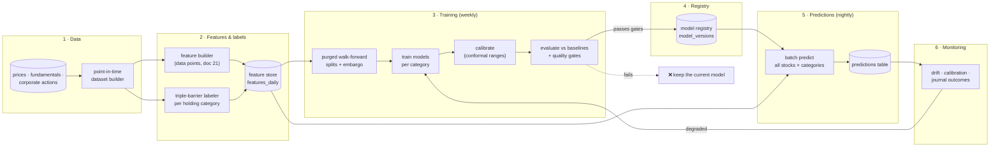

<!-- nav -->[← Previous](25-infrastructure-services-inventory.md) · [🏠 Index](README.md) · [Next →](27-phase1-poc-plan.md)

# 26 – ML Pipeline & Model Operations 🤖

**Purpose:** how the machine-learning side works end to end: data preparation, features, labels, training, validation,
the model registry, nightly predictions, retraining and monitoring. The *methods* are in
[18 – Methods, Accuracy & References 📐](18-methods-accuracy-references.md); this doc is the **pipeline** that runs them.

> All models are **pure statistics / ML on numeric data**. No LLM produces a prediction ([10](10-ai-llm-integration.md)).

## Pipeline overview

## 1. Data preparation (avoiding the classic traps)
| Trap | Problem | How we avoid it |
|---|---|---|
| **Look-ahead bias** | Using information that wasn't public yet | **Point-in-time** data: each fundamental value is used only from its **announcement date**, not its period-end date |
| **Survivorship bias** | Testing only on today's stocks ignores companies that were delisted or collapsed | Keep delisted stocks and **historical index membership** (e.g., NIFTY 50 as it was on each date) ⚠️ check provider coverage (Q49) |
| **Corporate actions** | Splits and bonuses look like crashes | Use adjusted prices; store adjustment factors |
| **Data leakage in splits** | Overlapping holding periods leak future returns into training | Purged walk-forward splits with an **embargo** equal to the holding period |
| **Restated financials** | Later corrections rewrite history | Keep the **first-reported** values for training |

## 2. Features
- Built from the data points in [21 – Stock Analysis Data Points 🧮](21-stock-analysis-datapoints.md): trend, valuation, profitability, growth, health, cash flow, ownership, market context
- **Cross-sectional normalisation:** ranks / z-scores within the universe on each date (e.g., "momentum in the top 20% of NSE today"), which makes features comparable across years
- **Sector-relative** versions for valuation and profitability
- Stored in a **feature store** table (`features_daily`: stock × date × feature set version), so training and prediction use **exactly the same features**
- Each feature set has a **version**; changing a feature creates a new version, never a silent change

## 3. Labels (what the model learns to predict)
For each stock, date and holding category (50D … 3Y):
| Label | Definition |
|---|---|
| Forward return | Return from the next day's open to the end of the holding period (net of costs) |
| Triple-barrier outcome | Which came first: target %, stop-loss, or time stop (matches the exit style, [12](12-entry-exit-strategy.md#-decision-exit-style--combination)) |
| Target-hit flags | Did it reach +5 / 10 / 15 / 20 / 25 / 30 / 40 / 50% before the stop? |
| Days to target | For survival analysis (censored if never reached) |
| Excess return vs NIFTY 50 | So the model learns to beat the market, not just ride it |

## 4. Models (one set per holding category)
| Output | Model | Library |
|---|---|---|
| Return range (p10 / p50 / p90) | Quantile gradient boosting | LightGBM |
| Probability of hitting each target | Gradient boosting classifiers + probability calibration | LightGBM, scikit-learn (isotonic) |
| Calibrated ranges | Conformal prediction wrapper | MAPIE |
| Days to target | Survival model | lifelines |
| Similar past setups | k-nearest neighbours on feature vectors | pgvector |
| **Baselines** (must be beaten) | Historical average return of the universe; momentum-only rule; rule-based quality score alone | — |

**Why gradient boosting (LightGBM) first:** it works very well on tabular financial data, trains in minutes on a **CPU**,
handles missing values, and is explainable with feature importance / SHAP. Deep learning only if it clearly beats this.

## 5. Training & validation
- **Schedule:** weekly (weekends), plus after a feature set change
- **Purged walk-forward:** train on years 1..N, test on year N+1, slide forward; embargo gap = holding period
- **Hyperparameter tuning:** small search (Optuna, optional) inside the training folds only
- **Reproducible:** fixed random seeds; every run records the data snapshot date, feature set version, code version (git commit) and parameters

### Quality gates (a new model replaces the current one only if all pass)
| Gate | Rule |
|---|---|
| Beats baselines | Better than every baseline on the out-of-sample periods |
| Calibration | Expected calibration error ≤ 5 percentage points |
| Range coverage | 80% range contains 75–85% of actual results |
| Stability | No single period with collapse (e.g., worse than baseline in > 30% of test windows) |
| No leakage alarm | Out-of-sample accuracy not suspiciously high (see [18](18-methods-accuracy-references.md#accuracy-what-to-expect)) |
| Not worse than the current model | On the latest test window |

## 6. Model registry & versioning
- Every trained model is stored with its metrics in `model_versions` (doc 17) and as a file in the `models` volume
- **MLflow** (recommended, runs locally as a container) tracks experiments, parameters, metrics and artifacts
- Status per version: `CANDIDATE` → `ACTIVE` → `RETIRED`; exactly one `ACTIVE` model per holding category
- **Rollback:** set the previous version back to `ACTIVE`
- Every prediction stores its `model_version_id`, so every number can be traced and explained

## 7. Nightly batch predictions
1. After the EOD data is final (≈ 20:00 IST), build today's features for all stocks
2. For each holding category: predict p10 / p50 / p90, target-hit probabilities, days to target
3. Write to the `predictions` table; the screener and journal read from it (fast queries, no live model calls)
4. When a journal plan starts, the prediction is **copied and locked** ([15](15-trade-journal.md))

## 8. Monitoring
| Monitor | Signal | Action |
|---|---|---|
| Feature drift | Feature distributions shift far from training (PSI) | Alert; consider retraining |
| Calibration drift | Rolling 3-month calibration error rising | Retrain; review features |
| Range coverage | Actual results outside ranges more than expected | Widen calibration; retrain |
| Journal outcomes | SUCCESS / PARTIAL / FAILURE rates per category ([15](15-trade-journal.md#-definition-of-success-prediction-accuracy)); many PARTIALs = model too cautious, many FAILUREs = too optimistic | Bias report; retrain / recalibrate |
| Data quality | Missing fields, stale data, provider changes | Block predictions for affected stocks |

## 9. Explainability
- Per prediction: the top features pushing it up or down (SHAP values), shown in the stock view:
  *"Main reasons: strong 6-month momentum, ROCE 24%, low debt; held back by high P/E vs history"*
- Per model: global feature importance in the model registry page

## 10. Compute
| Task | Hardware | Typical time (NIFTY 50 → all NSE) |
|---|---|---|
| Nightly features + predictions | CPU | Seconds → a few minutes |
| Weekly training (7 categories) | CPU, 4–8 cores | Minutes → under an hour |
| Backtests | CPU | Minutes → hours (run on weekends) |
| GPU | **Not needed** for these models (only for the optional LLM) | — |

## 11. Where the ML code lives (Clean Architecture)
| Piece | Layer / location ([24](24-coding-standards.md)) |
|---|---|
| Feature calculators, labelers, baselines (pure maths) | `domain/analysis/`, `domain/prediction/` |
| Ports: `FeatureStore`, `ModelRegistry`, `ModelTrainer` | `application/ports/ml.py` |
| Use cases: `BuildFeatures`, `TrainHoldingPeriodModels`, `RunNightlyPredictions`, `EvaluateModel` | `application/use_cases/ml/` |
| LightGBM / MAPIE / lifelines / MLflow adapters | `infrastructure/ml/` |
| Job entry points | `presentation/jobs/` |

## 12. ML libraries
| Purpose | Library |
|---|---|
| Data | pandas, numpy, (polars optional for speed) |
| Models | LightGBM, scikit-learn |
| Calibration / ranges | scikit-learn (isotonic), MAPIE |
| Survival | lifelines |
| Tuning | Optuna (optional) |
| Explainability | SHAP |
| Tracking / registry | MLflow |
| Backtesting | vectorbt (plans) and our own walk-forward evaluator |

## Related
- [18 – Methods, Accuracy & References 📐](18-methods-accuracy-references.md)
- [21 – Stock Analysis Data Points 🧮](21-stock-analysis-datapoints.md)
- [05 – Models & Evaluation](05-models-and-evaluation.md)
- [🏠 Index](README.md)

---
<!-- nav -->[← Previous](25-infrastructure-services-inventory.md) · [🏠 Index](README.md) · [Next →](27-phase1-poc-plan.md)
