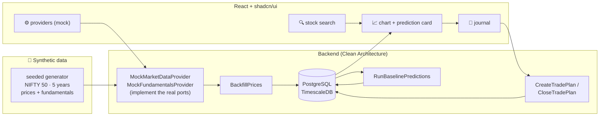

<!-- nav -->[← Previous](26-ml-pipeline.md) · [🏠 Index](README.md) · [Next →](28-open-questions.md)

# 27 – Phase 1 POC Plan (Synthetic Data) 🧪

**Purpose:** build a working **end-to-end proof of concept on dummy (synthetic) data**, so the whole flow
(data → database → prediction → journal → UI) is proven **before** any paid API is integrated.
Real providers (EODHD etc.) come afterwards, as a **config change** in the admin UI.

## Goal
> Open the app, search a NIFTY 50 stock, see its price chart and a prediction for each holding category
> (*"+9% (−6…+24%) · 41% chance of +20%"*), start a journal plan, close it, and see the outcome calculated.
> All on synthetic data, all running with `make dev`.

## Scope
| ✅ In the POC | ❌ Not in the POC (later) |
|---|---|
| Synthetic NIFTY 50 universe (5 years of daily prices + fundamentals) | Real market data / fundamentals APIs |
| Mock provider plugin behind the real provider ports | EODHD / FMP / vendor plugins |
| Database schema + Alembic migrations (TimescaleDB hypertable) | Full data point list (doc 21 research) |
| Domain core: value objects, holding categories, trading calendar, `TradePlan` with outcome rules | ML models (LightGBM, conformal), feature store |
| **Baseline prediction engine** (statistical, no ML) | Screener (Phase 4) |
| Trade journal: start, track, close, outcome | OAuth, users, invite codes (Phase 5b) |
| Admin › Data Providers (list + test the mock provider) | Encrypted credentials for real providers (table ready, UI later) |
| React UI with shadcn/ui: stock search, chart, prediction card, journal | 24/7 scheduler, EOD report, WhatsApp |
| Manual "run jobs" commands (`make seed`, `make predict`) | Short-term engine |

## POC flow

## Synthetic data design
| Item | How it's generated |
|---|---|
| Universe | The 50 NIFTY 50 **symbols and sectors** (public information); market `IN`, exchange `NSE`, currency `INR`, timezone `Asia/Kolkata` |
| Prices | 5 years of trading days (weekdays minus a sample NSE holiday list); **geometric Brownian motion with regimes** (bull / bear / sideways), per-stock drift and volatility by sector, realistic OHLC and volume |
| Corporate actions | A few **splits/bonuses** so price adjustment is exercised |
| Fundamentals | Quarterly statements and ratios (ROE, ROCE, D/E, growth, promoter holding, pledge) within plausible sector ranges |
| NIFTY 50 index | Weighted from the synthetic constituents |
| Determinism | **Fixed random seed**: every run produces the same data, so tests and demos are repeatable |
| Labelling | Every record has `source_provider = "mock"`; the UI shows a **"SYNTHETIC DATA"** badge so it's never mistaken for real prices |

## Baseline prediction engine (POC)
Pure statistics, no ML. It is also the **baseline** that the later ML models must beat ([26](26-ml-pipeline.md#4-models-one-set-per-holding-category)).
1. For each stock and holding category (50D … 3Y), take every historical start date in its past
2. Compute the forward return over that holding period (empirical distribution)
3. Output **p10 / p50 / p90** and the **probability of hitting each target** (5 … 50%) before a −7% stop
4. Store in `predictions` with `model_version = baseline-empirical-v1`

## Milestones (each one is a small PR into `develop`)
Outcomes, acceptance criteria and evidence for each milestone: [deliverables/phase-01-foundation-poc.md](deliverables/phase-01-foundation-poc.md) (M0–M7 = D1.0–D1.7).

| # | Milestone | Main work | Done when |
|---|---|---|---|
| **M0** | Tooling | pre-commit installed; `make lint` + `make test` green; shadcn/ui initialised; Q55 naming decided | Clean lint/test run in containers |
| **M1** | Database | SQLAlchemy models + first Alembic migrations: `markets`, `stocks`, `prices_daily` (hypertable), `fundamentals`, `corporate_actions`, `predictions`, `model_versions`, `trade_plans`, `plan_daily_status`, `providers`, `provider_assignments`, `job_runs` | `alembic upgrade head` works on `dev_stock_analyzer`; downgrade works |
| **M2** | Domain core | `Money`, `Percentage`, `Symbol`, `HoldingCategory`, `ReturnRange`, `TradingCalendar`, `TradePlan` (lock, close, outcome with tolerance), domain errors | Unit tests ≥ 90% on `domain/` |
| **M3** | Mock provider + data load | Provider ports, registry/router, synthetic generator, `MockMarketDataProvider`, `MockFundamentalsProvider`, `BackfillPrices` use case, `make seed` | NIFTY 50 × 5 years in the DB; re-running is idempotent |
| **M4** | Baseline predictions | `RunBaselinePredictions` use case, `make predict` | Predictions for 50 stocks × 7 categories; leakage test passes |
| **M5** | API | `/api/stocks`, `/api/stocks/{symbol}/prices`, `/api/predictions/{symbol}`, `/api/trade-plans` (create, list, get, close), `/api/admin/providers` (list, test) | OpenAPI documented; e2e tests pass; `make api-client` regenerated |
| **M6** | Frontend | Layout + navigation, stock search (combobox), price chart (Lightweight Charts), prediction card, journal pages (new plan, list, close), providers page; SYNTHETIC badge | Click-through demo works at `localhost:5173` |
| **M7** | Wrap-up | Demo script, docs updated, CHANGELOG, PR `feature/phase1-foundation` → `develop` | Definition of Done ([24](24-coding-standards.md#9-definition-of-done-every-change)) met |

Branching: work happens on `feature/phase1-foundation` (or one `feature/phase1-mN-…` branch per milestone, merged into it).

## Defaults used in the POC (decisions still open for Phase 2)
| Question | POC default (configurable, can change later) |
|---|---|
| Q28 calendar vs trading days | Calendar days in the UI, converted to trading days |
| Q29 entry price | Synthetic close of the start date, editable |
| Q31 own target % | Allowed; the system prediction is stored alongside |
| Stop-loss | −7% default, editable per plan |
| Success tolerance | ±0.5 pp (decided) |

## Switching to real data later
1. Add the real provider plugin (e.g., EODHD) behind the **same ports**
2. Configure it in Admin › Data Providers and run the coverage check
3. Set it as **primary**; keep mock for dev and test
4. Re-run the backfill; the rest of the system (predictions, journal, UI) is unchanged

## Risks
| Risk | Mitigation |
|---|---|
| Synthetic data looks "too good" and hides real-world problems | Regimes, crashes, gaps and corporate actions in the generator; real data replaces it before any conclusions are drawn |
| POC shortcuts become permanent | Every milestone follows the coding standards and Definition of Done; no "POC-only" code paths |
| Mistaking synthetic for real prices | `source_provider = mock` on every record and a visible SYNTHETIC badge |

## Related
- [09 – Roadmap](09-roadmap.md)
- [24 – Coding Standards & Clean Architecture 📏](24-coding-standards.md)
- [22 – Data Provider Configuration (In-App UI) ⚙️](22-provider-configuration-ui.md)
- [🏠 Index](README.md)

---
<!-- nav -->[← Previous](26-ml-pipeline.md) · [🏠 Index](README.md) · [Next →](28-open-questions.md)
