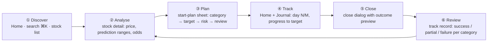
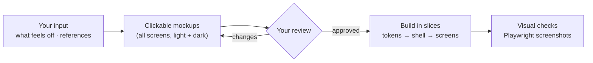

<!-- nav -->[← Previous](27-phase1-poc-plan.md) · [🏠 Index](README.md)

# 28 – UI/UX Redesign Plan (End to End) 🎨

**Purpose:** the POC UI works but looks and feels unfinished ("slop"). This plan redesigns it **end to end**:
user journeys, information architecture, a real design system, every screen, data visualisation, states, accessibility,
and a review gate **before** code is written. Backend and API stay as they are unless a screen needs new data.

## 1. Diagnosis: what's wrong today
Audit of `frontend/src` (2026-10-31), no visual review yet:
| # | Finding | Evidence | Effect |
|---|---|---|---|
| 1 | No design system in use | **29** hardcoded `slate-*` classes, **0** design-token classes | Screens and shadcn components look like two different apps; no dark mode |
| 2 | Emoji used as icons | **10** emoji in nav, outcomes and status | Looks casual, renders differently per OS, not accessible |
| 3 | Mixed controls | **2** native `<select>` next to shadcn inputs | Inconsistent look and keyboard behaviour |
| 4 | No feedback patterns | **0** skeletons, dialogs, sheets, tooltips, toasts; **4** plain-text "Loading…" | Layout jumps, unclear success/failure |
| 5 | Numbers not aligned | **0** `tabular-nums` | Columns of prices and % look ragged |
| 6 | Predictions are text, not visuals | Headline string in a monospace table cell | The most important output is the hardest to read |
| 7 | Chart not themed | **9** hardcoded hex colours; no time-range controls | Doesn't match the app; can't zoom to 1M/6M/1Y/5Y |
| 8 | Weak hierarchy | Stock page is one long column of equal cards; long field labels ("Target % (empty = predicted median)") | No clear "what matters first" |
| 9 | Cramped actions | Plan closing is an inline form inside a table row | Error-prone, no confirmation, no preview of the outcome |
| 10 | No home | `/` is a backend health card | No overview of plans, P/L or what to do next |

## 2. Design direction
- **Data-dense but calm:** the look of a professional finance tool (reference feel: Zerodha Kite, Tickertape, Screener), not a marketing site
- **Numbers first:** the prediction range and probability are the hero, shown as visuals with the exact numbers alongside
- **One system:** every colour, size and spacing comes from design tokens; light and dark themes from day one
- **Honest by design:** uncertainty is always visible (ranges, probabilities), SYNTHETIC data always labelled, outcomes never ambiguous
- **Fast paths:** search from anywhere (⌘K), start a plan in under 30 seconds, close one with a preview of the outcome

## 3. End-to-end user journeys

| Journey | Today | Target |
|---|---|---|
| Discover | Search box + card grid | Global ⌘K command palette + sortable stock table (sector filter, last close, 1Y range, sparkline) |
| Analyse | Chart + text table | Header KPIs, themed chart with 1M/6M/1Y/5Y, **range bars** per holding category, target odds chart |
| Plan | Form at page bottom | Side **sheet** with steps and a live preview (target/stop prices, end date, suggested amount) |
| Track | Table only | Home dashboard: active plans with progress bars to target/stop and days left |
| Close | Inline row form | **Dialog** with exit date/price and a live outcome preview before confirming |
| Review | Not present | Track-record summary per category (success / partial / failure, avg actual vs predicted) |

## 4. Information architecture
| Route | Screen | Purpose |
|---|---|---|
| `/` | **Home (dashboard)** | Active plans, P/L, recent outcomes, quick search |
| `/stocks` | **Stocks** | Sortable, filterable table of the universe |
| `/stocks/:symbol` | **Stock detail** | Analyse + start a plan |
| `/journal` | **Journal** | Tabs: Active · Closed · Track record |
| `/admin/providers` | **Providers** | Provider list, test, (later) configure |
| `/status` | System status | Backend health (moved out of Home) |

App shell: collapsible left sidebar (icons + labels, Lucide icons), top bar with ⌘K search, market status (NSE open/closed, IST time), data badge (**SYNTHETIC** / provider name), theme toggle.

## 5. Screen specifications
### Home
- KPI row: active plans · open P/L · success rate (closed) · plans ending this week
- Active plans list: symbol, category, day N of M, progress bar (stop ← entry → target), current return
- Recent outcomes, and empty state with "Find a stock" call to action

### Stocks
- Data table (TanStack Table): symbol + name, sector, last close, 1-day %, 1Y return, **1Y median prediction**, chance up; sortable, sector filter, search
- Row click → stock detail; skeleton rows while loading

### Stock detail
- **Header:** symbol, name, sector, last close (large), day change, SYNTHETIC badge, **Start plan** button
- **Chart card:** themed candlesticks, volume, 1M / 6M / 1Y / 5Y / All, crosshair tooltip, plan lines (entry/target/stop)
- **Predictions card (the hero):** one row per holding category with a **range bar** (p10–p90 band, p50 marker, zero line), median %, chance up, chance of the selected target, CAGR for 1Y+; target chips (+5 … +50%)
- **Target odds chart:** probability of reaching each target for the selected category (bar chart)
- **Plans for this stock:** active + recent, with outcome badges
- Footnote: "Baseline statistics from past prices, not advice"

### Start-plan sheet (side panel)
Steps: ① holding category (cards showing median and range) → ② target (prefilled with the median; slider + input) → ③ risk (stop-loss %, tolerance ±pp; suggested amount from risk % and capital) → ④ review (entry, target and stop prices, planned end date, locked prediction) → **Start plan** → toast + link to the journal

### Journal
- Tabs **Active / Closed / Track record**
- Active: progress bars, days left, **Close** button → dialog
- Close dialog: exit date + price, **live outcome preview** ("+10.7% vs +10.5% predicted, ±0.5 pp → Success"), confirm
- Closed: outcome badges (icon + colour + text), actual vs predicted, filters by category and outcome
- Track record: success / partial / failure per category (stacked bars), avg actual vs predicted

### Providers
- Card per provider: name, kind, status pill, last test result + time, **Test connection** with spinner + toast

## 6. Design system
| Area | Decision |
|---|---|
| Tokens | Use the shadcn CSS variables only (`background`, `foreground`, `muted`, `card`, `primary`, `border`, `ring`, `chart-1…5`); add semantic **gain**, **loss**, **warning**, **synthetic** tokens; no raw `slate-*`/hex in features |
| Themes | Light + dark from tokens; theme toggle, remembers the choice |
| Typography | Geist (already installed); **tabular-nums** for every number; sizes: page title, section title, body, small, KPI number |
| Icons | Lucide (already a dependency); no emoji in UI |
| Components (shadcn) | Button, Input, Select, Combobox/Command (⌘K), Sheet, Dialog, Tabs, Table + DataTable, Tooltip, Skeleton, Sonner toasts, Badge, Progress, Slider, Card, Separator |
| Charts | Lightweight Charts themed from tokens (price); Recharts or shadcn Charts for bars (odds, track record) |
| Numbers | `formatInr` (lakh/crore), `formatPct` (sign + true minus), probabilities as %, dates in IST; gain/loss colour **plus** sign (never colour only) |
| Spacing / layout | 4-px scale; max content width; 12-column grid on stock detail (chart 8 / side panel 4 on desktop) |

## 7. States & feedback
| State | Pattern |
|---|---|
| Loading | Skeletons shaped like the content (no layout jump) |
| Empty | Icon + one sentence + primary action |
| Error | Inline alert with the API message + retry |
| Success | Toast with a link (e.g., "Plan #12 started → View") |
| Destructive / irreversible | Confirmation dialog (closing a plan) |
| Disabled | Explains why (tooltip) |

## 8. Accessibility & responsiveness
- WCAG 2.1 AA contrast in both themes; visible focus rings; full keyboard use (⌘K, sheet, dialog, table)
- Outcome and gain/loss never shown by colour alone (icon + text + sign)
- Breakpoints: phone (stacked, bottom nav), tablet, desktop (sidebar); tables become cards on phones
- Check with the accessibility review skill before sign-off

## 9. Process: design before code

1. **Input (you):** what feels most wrong, reference apps you like, dark or light default, phone priority
2. **Mockups:** clickable HTML mockups of every screen (using the real synthetic numbers), shared as a link for review
3. **Review gate:** nothing is built until you approve the mockups
4. **Build in slices**, each its own PR into `develop`; Playwright screenshots in light + dark recorded as evidence

## 10. Milestones
| # | Milestone | Done when |
|---|---|---|
| UI-0 | Input + mockups approved | You approve the mockups (design review recorded) |
| UI-1 | Design system: tokens, themes, typography, icons, missing shadcn components, formatters | No `slate-*`/hex/emoji left in features (lint rule); light/dark toggle works |
| UI-2 | App shell: sidebar, top bar, ⌘K search, market status, data badge, routes (`/` Home, `/status`) | Keyboard-only navigation works |
| UI-3 | Stock detail: header, themed chart with ranges, range-bar predictions, odds chart | Matches mockup; screenshots light/dark |
| UI-4 | Start-plan sheet + close dialog with outcome preview + toasts | Playwright: start → close → outcome |
| UI-5 | Stocks table, Journal tabs + track record, Home dashboard, Providers cards | Matches mockups |
| UI-6 | States, accessibility, responsive pass | Skeleton/empty/error on every screen; a11y review clean; phone layout |

Backend additions likely needed (small, read-only): day change + 1Y return per stock for the Stocks table, and a journal summary endpoint for Home and the track record.

## 11. Questions for you
Recorded in the decision log as Q58–Q62:
1. What feels most "sloppy" to you (layout, colours, typography, density, the predictions, the forms)?
2. Reference apps whose look you like (e.g., Kite, Tickertape, Screener, TradingView, others)?
3. Default theme: light, dark, or follow the system?
4. Phone use: important now, or desktop first?
5. Mockups as clickable HTML pages shared by link (recommended), or straight to code?

## Related
- [23 – Frontend (React) & Backend Split 🖥️](23-frontend-react.md)
- [06 – App Features & UI](06-app-features.md)
- [24 – Coding Standards & Clean Architecture 📏](24-coding-standards.md)
- [🏠 Index](README.md)

---
<!-- nav -->[← Previous](27-phase1-poc-plan.md) · [🏠 Index](README.md)
