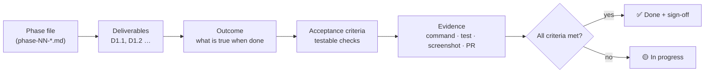

[🏠 Docs index](../README.md) · [🗺️ Roadmap](../09-roadmap.md)

# Deliverables & Outcomes 🎯

**Purpose:** define, for every phase and deliverable, **the outcome it must achieve**, how that is **verified**, and its **status**.
The planning docs say *what we will build*; this folder says *what "done" means* and records the proof.

## How it works

## Phases
| Phase | File | Phase outcome | Status |
|---|---|---|---|
| 1 – Foundation (POC, synthetic data) | [phase-01-foundation-poc.md](phase-01-foundation-poc.md) · [demo](phase-01-demo.md) | End-to-end flow works on synthetic data | 🟡 In progress |
| 1b – UI/UX Redesign | [phase-01b-ui-redesign.md](phase-01b-ui-redesign.md) | The POC flow feels like a finished finance tool; mockups approved before build | 🔵 Planned |
| 2 – Trade Journal | [phase-02-trade-journal.md](phase-02-trade-journal.md) | Plans can be tracked manually with honest outcomes | ⚪ Not started |
| 3 – Long-Term Engine | [phase-03-long-term-engine.md](phase-03-long-term-engine.md) | ML predictions with calibrated ranges beat the baselines | ⚪ Not started |
| 4 – Screener | [phase-04-screener.md](phase-04-screener.md) | "N days, X% → which stocks?" answered in seconds | ⚪ Not started |
| 5 – Validation | [phase-05-validation.md](phase-05-validation.md) | Usefulness proven (or disproven) with out-of-sample evidence | ⚪ Not started |
| 5b – Users | [phase-05b-users.md](phase-05b-users.md) | Others sign up with OAuth + invite code; data separated | ⚪ Not started |
| 5c – WhatsApp | [phase-05c-whatsapp.md](phase-05c-whatsapp.md) | Daily report and alerts arrive on WhatsApp | ⚪ Not started |
| 6 – Daily Ops | [phase-06-daily-ops.md](phase-06-daily-ops.md) | Runs unattended 24/7 with a daily returns report | ⚪ Not started |
| 7 – Short-Term | [phase-07-short-term.md](phase-07-short-term.md) | 1 day – 2 weeks engine available | ⚪ Not started |
| 8 – Optional add-ons | [phase-08-optional.md](phase-08-optional.md) | LLM explanations, auto paper trading | ⚪ Not started |

**Status values:** ⚪ Not started · 🔵 Planned · 🟡 In progress · ✅ Done · ⛔ Blocked · ❌ Dropped

## Rules
1. Every deliverable has an **ID** (`D<phase>.<n>`, e.g., `D1.3`), one **outcome statement**, **acceptance criteria** and **evidence**
2. An outcome describes a **result the user or system can observe**, not an activity ("prices for 50 stocks are queryable", not "write the loader")
3. Acceptance criteria are **testable**: each one has a command, test, URL or screenshot that proves it
4. A deliverable is ✅ only when **every** criterion has evidence recorded in its table
5. A phase is ✅ only when all its deliverables are ✅ and the **phase exit criteria** are met; then add the sign-off
6. Changes in scope are recorded in the phase file's **change log**, not silently edited
7. New phase or deliverable → copy [TEMPLATE.md](TEMPLATE.md)

## Related
- [09 – Roadmap](../09-roadmap.md)
- [27 – Phase 1 POC Plan (Synthetic Data) 🧪](../27-phase1-poc-plan.md)
- [24 – Coding Standards & Clean Architecture 📏](../24-coding-standards.md) (Definition of Done)
